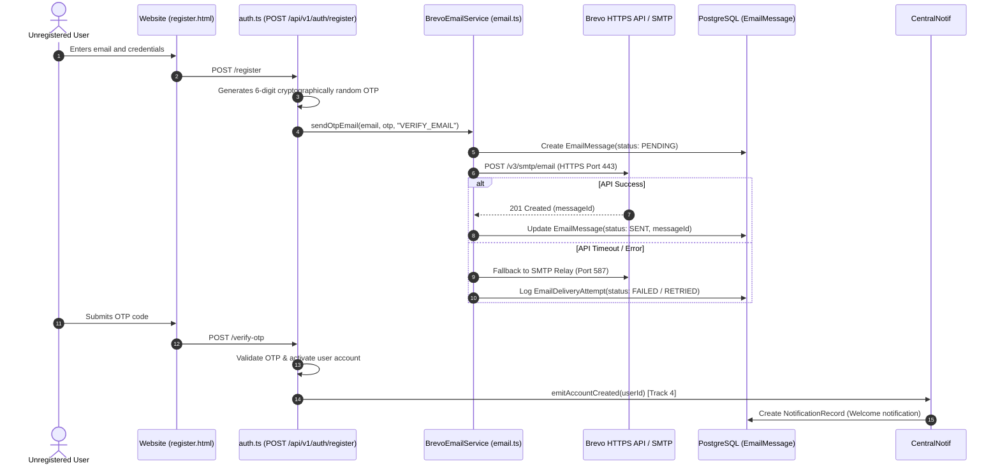
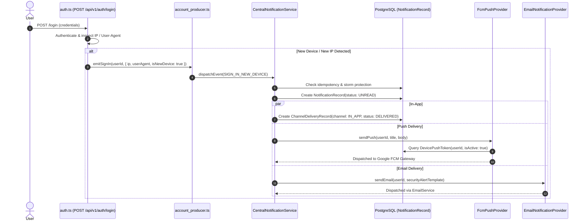
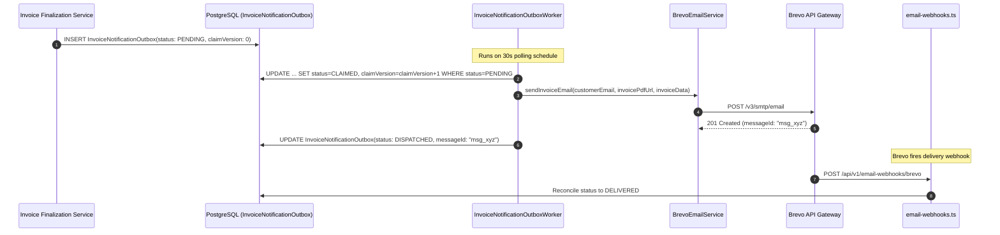

# ZDEXCLOUD PHASE 11.1 REPORT: COMPLETE NOTIFICATION SYSTEM INVENTORY

**Date:** 2026-10-15  
**Execution Phase:** Phase 11.1 — Complete Notification System Inventory  
**Scope:** Repository-Grounded Inventory across Backend, Main Website, and Android Application  
**Execution Mode:** Pure Discovery & Audit (Zero code mutation, zero live dispatches, zero schema migrations)

---

## 1. Executive Summary

ZdexCloud currently possesses an advanced, multi-tier notification and messaging architecture consisting of **four distinct communication pipelines** developed across various engineering phases. While each subsystem is engineered with high resilience, transactional safeguards, and defensive measures, they operate largely in architectural silos with significant gaps in cross-channel event propagation.

### Core Architectural Subsystems Identified
1. **Track 4 Central Notification Engine (`src/notifications/`):**
   - High-throughput, multi-channel notification dispatcher backed by `NotificationRecord` and `ChannelDeliveryRecord` in PostgreSQL via Prisma.
   - Supports 23 event types across Account Security, Device & Server lifecycle, File operations, Storage alerts, and System notices.
   - Dispatches in-app notifications, FCM push messages (`FcmPushProvider`), and rendered HTML emails (`EmailNotificationProvider`).
   - Equipped with robust reliability primitives: Redis/in-memory idempotency (`idempotency.ts`), storm protection and flapping coalescer (`storm_protection.ts`), tiered rate limiting (`rate_limiter.ts`), circuit breakers (`provider_circuit_breaker.ts`), and exponential backoff retry policies (`retry_policy.ts`).
   - Powered by two background workers: `DeliveryWorker` and `RetentionWorker`.
2. **Direct Transactional Authentication Email Pipeline (`src/services/email.ts`):**
   - Direct caller of Brevo HTTPS API (with Brevo SMTP fallback) for OTP delivery (registration, sign-in 2FA, password change verification, password reset).
   - Directly creates records in the `EmailMessage` and `EmailDeliveryAttempt` tables.
   - Bypasses the Track 4 notification pipeline, meaning OTP dispatches do not produce in-app `NotificationRecord`s or push notifications.
3. **Billing Invoice Outbox Pipeline (`src/services/billing/`):**
   - Monotonically fenced transactional outbox (`InvoiceNotificationOutbox`) driven by `InvoiceNotificationOutboxWorker`.
   - Sends finalized PDF tax invoice links via `BillingInvoiceNotificationService` and `BrevoEmailService`.
   - Reconciles delivery state via Brevo webhooks (`EmailWebhookInbox`).
   - **Key Architectural Disconnect:** Billing events (invoicing, payments, subscription renewals/failures) are completely omitted from Track 4 `NotificationRecord`. Customers receive no in-app notifications in the web or mobile notification center for billing events.
4. **Customer Activity History Feed (`CustomerActivityEvent`):**
   - Audit and activity log stream queried via `GET /api/v1/account/activity` and rendered on `pages/activity.html`.
   - Records security and administrative events for compliance, completely decoupled from customer notification badges and alerts.

---

## 2. Files & Modules Inspected

### A. Backend Core & Database Schema
- `prisma/schema.prisma`:
  - `NotificationRecord`: User-facing in-app notifications, status (`UNREAD`, `READ`, `ARCHIVED`), idempotency key, deep links (`deepLinkUri`, `webPath`), metadata.
  - `ChannelDeliveryRecord`: Per-channel delivery attempts (`IN_APP`, `PUSH`, `EMAIL`), status (`QUEUED`, `DELIVERED`, `FAILED`, `PERMANENTLY_FAILED`), retry counts, next retry timestamp.
  - `UserNotificationPreferences`: Notification opt-ins/opt-outs (`globalPushEnabled`, `globalEmailEnabled`, `categoryPreferences` JSON).
  - `DevicePushToken`: Registered client device push tokens (`token`, `platform`, `isActive`, `lastSeenAt`, `revokedAt`).
  - `EmailMessage` & `EmailDeliveryAttempt`: Central transactional email logs, status, tracking IDs.
  - `InvoiceNotificationOutbox`: Transactional outbox records for billing notifications with claim fencing.
  - `EmailWebhookInbox`: Inbound Brevo webhook receipt and reconciliation tracking.

### B. Track 4 Notification Engine (`src/notifications/`)
- `services/notification_service.ts`: `CentralNotificationService` class, `dispatchEvent()` method, channel distribution orchestration.
- `type_registry.ts`: 23 defined `NotificationType`s, severity mappings, default channel mappings, category mappings (`ACCOUNT_SECURITY`, `DEVICE_SERVER`, `FILE_OPERATIONS`, `STORAGE`, `SYSTEM`).
- `providers/fcm_provider.ts`: `FcmPushProvider` utilizing Google Firebase Cloud Messaging v1 REST API with mock fallback when credentials are absent.
- `providers/email_provider.ts`: `EmailNotificationProvider` rendering branded HTML templates and delegating to `emailService.sendRawMail()`.
- `reliability/idempotency.ts`: Dual-layer deduplication (memory cache + Prisma unique constraint handling).
- `reliability/storm_protection.ts`: Suppression windows, flapping event coalescing, and anti-spam protection.
- `reliability/rate_limiter.ts`: Tiered sliding window rate limiting.
- `reliability/provider_circuit_breaker.ts`: Circuit breaker for push and email providers.
- `reliability/retry_policy.ts`: Exponential backoff with jitter and max attempt caps.
- `workers/delivery_worker.ts`: Polling worker for queued channel deliveries.
- `workers/retention_worker.ts`: Data purge worker for expired notifications and delivery records.
- `routes/notification_routes.ts`: `GET /notifications`, `GET /notifications/unread-count`, `PATCH /notifications/:id/read`, `POST /notifications/read-all`, `GET /notifications/health`, `POST /notifications/test-push`.
- `routes/preference_routes.ts`: `GET /notifications/preferences`, `PUT /notifications/preferences`.
- `routes/push_token_routes.ts`: `POST /devices/:deviceId/push-token`, `PATCH /devices/:deviceId/push-token`, `DELETE /devices/:deviceId/push-token`.

### C. Event Producers (`src/notifications/producers/`)
- `account_producer.ts`: Produces `ACCOUNT_CREATED`, `SIGN_IN_NEW_DEVICE`, `PASSWORD_CHANGED`, `PASSWORD_RESET_REQUESTED`, `SECURITY_ALERT`.
- `device_producer.ts`: Produces `DEVICE_LINKED`, `DEVICE_OFFLINE`, `DEVICE_REMOVED`.
- `server_producer.ts`: Produces `SERVER_CREATED`, `SERVER_ONLINE`, `SERVER_OFFLINE`, `SERVER_ERROR`.
- `file_producer.ts`: Produces file operation alerts (`FILE_UPLOAD_COMPLETED`, `FILE_UPLOAD_FAILED`, etc.) — *Uncalled / Orphaned*.
- `storage_producer.ts`: Produces storage warnings (`STORAGE_WARNING`, `STORAGE_CRITICAL`) — *Uncalled / Orphaned*.
- `gateway_producer.ts`: Produces gateway connection events (`GATEWAY_CONNECTED`, `GATEWAY_DISCONNECTED`) — *Uncalled / Orphaned*.

### D. Direct Email & Billing Outbox Services
- `src/services/email.ts`: `BrevoEmailService` handling direct OTP dispatches and transactional emails.
- `src/services/billing/billing_invoice_notification_service.ts`: Finalized invoice notification generator.
- `src/services/billing/invoice_notification_outbox_worker.ts`: Outbox queue runner with claim fencing.
- `src/routes/email-webhooks.ts`: Webhook receiver for Brevo email events.
- `src/services/email_webhook_service.ts`: Webhook reconciliation logic updating `EmailMessage` and `InvoiceNotificationOutbox`.

### E. Main Website Frontend (`main website/Frontend/`)
- `pages/notifications.html`: Notification center page with tabs, filter pills, and notification list.
- `js/notification-center.js`: Frontend notification controller, unread counter badge updater, mark-as-read dispatcher, deep link navigation router (`resolveDeepLinkWebPath`).
- `js/api.js`: Authenticated API client handling request interceptors and token propagation.
- `pages/settings.html` & `js/settings.js`: User profile and notification preference toggle UI.

### F. Android Client Application (`Android app/Android app code/`)
- `lib/screens/notification_center_screen.dart`: Flutter notification UI with pull-to-refresh, filter tabs, and mark-all-as-read.
- `lib/screens/notification_preferences_screen.dart`: Notification preferences UI toggling push and email options.
- `lib/providers/notification_provider.dart`: State management for notifications, badge counts, and preferences.
- `lib/services/push_notification_service.dart`: Push notification service managing device token registration.
- `lib/services/push_token_manager.dart`: Token storage and sync with backend `/devices/:deviceId/push-token`.
- `android/app/src/main/kotlin/com/example/zdexcloud/MainActivity.kt`: Native Android platform channel handling notifications and permissions.
- `android/app/src/main/kotlin/com/example/zdexcloud/RemoteNodeServerService.kt`: Android foreground service with persistent status notification.

---

## 3. Consolidated Notification Inventory

| # | Event Name | Business Trigger | Producer Component | Recipient | Channels | Content / Template | Persistence Model | Retries / Backoff | Deduplication / Idempotency | Preferences Checked | Source File & Symbol | Current Status |
|---|---|---|---|---|---|---|---|---|---|---|---|---|
| 1 | `ACCOUNT_CREATED` | New user signs up and verifies email | `account_producer.ts` | New User | In-App, Push, Email | `Account created welcome` | `NotificationRecord`, `ChannelDeliveryRecord` | 3 attempts, exponential backoff | Yes (`acc_created_<userId>`) | Yes (`ACCOUNT_SECURITY`) | `account_producer.ts:emitAccountCreated` | **Active** (Invoked in `auth.ts`) |
| 2 | `SIGN_IN_NEW_DEVICE` | Sign-in from new IP / User-Agent | `account_producer.ts` | Account Owner | In-App, Push, Email | `New sign-in alert with IP/device` | `NotificationRecord`, `ChannelDeliveryRecord` | 3 attempts, exponential backoff | Yes (`signin_<userId>_<hash>`) | Yes (`ACCOUNT_SECURITY`) | `account_producer.ts:emitSignIn` | **Active** (Invoked in `auth.ts`) |
| 3 | `PASSWORD_CHANGED` | User updates password in Settings | `account_producer.ts` | Account Owner | In-App, Push, Email | `Password change confirmation` | `NotificationRecord`, `ChannelDeliveryRecord` | 3 attempts, exponential backoff | Yes (`pwd_changed_<userId>_<ts>`) | Yes (`ACCOUNT_SECURITY`) | `account_producer.ts:emitSecurityEvent` | **Active** (Invoked in `auth.ts`) |
| 4 | `PASSWORD_RESET_REQUESTED` | Password reset OTP requested | `account_producer.ts` | Account Owner | In-App, Push, Email | `Security notice of reset request` | `NotificationRecord`, `ChannelDeliveryRecord` | 3 attempts, exponential backoff | Yes (`pwd_reset_<userId>_<ts>`) | Yes (`ACCOUNT_SECURITY`) | `account_producer.ts:emitSecurityEvent` | **Active** (Invoked in `auth.ts`) |
| 5 | `SECURITY_ALERT` | Multiple failed logins / suspicious event | `account_producer.ts` | Account Owner | In-App, Push, Email | `Suspicious security activity notice` | `NotificationRecord`, `ChannelDeliveryRecord` | 3 attempts, exponential backoff | Yes (`sec_alert_<userId>_<type>`) | Yes (`ACCOUNT_SECURITY`) | `account_producer.ts:emitSecurityEvent` | **Active** (Invoked in `auth.ts`) |
| 6 | `DEVICE_LINKED` | New device paired to account | `device_producer.ts` | Device Owner | In-App, Push | `Device linked confirmation` | `NotificationRecord`, `ChannelDeliveryRecord` | 3 attempts, exponential backoff | Yes (`dev_link_<deviceId>`) | Yes (`DEVICE_SERVER`) | `device_producer.ts:emitDeviceLinked` | **Active** (Invoked in `device.ts`) |
| 7 | `DEVICE_OFFLINE` | Device heartbeat lost | `device_producer.ts` | Device Owner | In-App, Push | `Device unreachable warning` | `NotificationRecord`, `ChannelDeliveryRecord` | 3 attempts, exponential backoff | Yes (Storm suppressed) | Yes (`DEVICE_SERVER`) | `device_producer.ts:emitDeviceOffline` | **Partially Wired** (Health monitor) |
| 8 | `DEVICE_REMOVED` | Device unlinked from account | `device_producer.ts` | Device Owner | In-App, Push | `Device removed notice` | `NotificationRecord`, `ChannelDeliveryRecord` | 3 attempts, exponential backoff | Yes (`dev_rem_<deviceId>`) | Yes (`DEVICE_SERVER`) | `device_producer.ts:emitDeviceRemoved` | **Active** (Invoked in `device.ts`) |
| 9 | `SERVER_CREATED` | New storage server created | `server_producer.ts` | Server Owner | In-App, Push | `Server creation notification` | `NotificationRecord`, `ChannelDeliveryRecord` | 3 attempts, exponential backoff | Yes (`srv_new_<serverId>`) | Yes (`DEVICE_SERVER`) | `server_producer.ts:emitServerCreated` | **Active** (Invoked in `device.ts`) |
| 10 | `SERVER_ONLINE` | Server establishes connectivity | `server_producer.ts` | Server Owner | In-App, Push | `Server online status notice` | `NotificationRecord`, `ChannelDeliveryRecord` | 3 attempts, exponential backoff | Yes (State-flip coalesced) | Yes (`DEVICE_SERVER`) | `server_producer.ts:emitServerOnline` | **Partially Wired** (State machine) |
| 11 | `SERVER_OFFLINE` | Server heartbeat timed out | `server_producer.ts` | Server Owner | In-App, Push | `Server offline warning` | `NotificationRecord`, `ChannelDeliveryRecord` | 3 attempts, exponential backoff | Yes (Storm suppressed) | Yes (`DEVICE_SERVER`) | `server_producer.ts:emitServerOffline` | **Partially Wired** (State machine) |
| 12 | `SERVER_ERROR` | Server critical error reported | `server_producer.ts` | Server Owner | In-App, Push, Email | `Server error alert` | `NotificationRecord`, `ChannelDeliveryRecord` | 3 attempts, exponential backoff | Yes (`srv_err_<id>_<ts>`) | Yes (`DEVICE_SERVER`) | `server_producer.ts:emitServerError` | **Partially Wired** |
| 13 | `GATEWAY_CONNECTED` | Gateway connection established | `gateway_producer.ts` | Server Owner | In-App | `Gateway connected notice` | `NotificationRecord`, `ChannelDeliveryRecord` | 3 attempts, exponential backoff | Yes (`gw_conn_<id>`) | Yes (`DEVICE_SERVER`) | `gateway_producer.ts:emitConnected` | **Orphaned** (Not invoked in state machine) |
| 14 | `GATEWAY_DISCONNECTED` | Gateway connection dropped | `gateway_producer.ts` | Server Owner | In-App | `Gateway disconnected warning` | `NotificationRecord`, `ChannelDeliveryRecord` | 3 attempts, exponential backoff | Yes (`gw_disc_<id>`) | Yes (`DEVICE_SERVER`) | `gateway_producer.ts:emitDisconnected` | **Orphaned** (Not invoked in state machine) |
| 15 | `FILE_UPLOAD_COMPLETED` | Large file upload completed | `file_producer.ts` | User | In-App | `File upload complete notice` | `NotificationRecord`, `ChannelDeliveryRecord` | 3 attempts, exponential backoff | Yes (`fup_done_<fileId>`) | Yes (`FILE_OPERATIONS`) | `file_producer.ts:emitUploadCompleted` | **Orphaned** (Not called in `file-manager.ts`) |
| 16 | `FILE_UPLOAD_FAILED` | File upload failed or aborted | `file_producer.ts` | User | In-App | `File upload failed alert` | `NotificationRecord`, `ChannelDeliveryRecord` | 3 attempts, exponential backoff | Yes (`fup_fail_<fileId>`) | Yes (`FILE_OPERATIONS`) | `file_producer.ts:emitUploadFailed` | **Orphaned** (Not called in `file-manager.ts`) |
| 17 | `FILE_DOWNLOAD_COMPLETED`| File download batch packaged | `file_producer.ts` | User | In-App | `File download ready notice` | `NotificationRecord`, `ChannelDeliveryRecord` | 3 attempts, exponential backoff | Yes (`fdl_done_<id>`) | Yes (`FILE_OPERATIONS`) | `file_producer.ts:emitDownloadCompleted` | **Orphaned** |
| 18 | `FILE_SHARE_ACCESSED` | Shared file downloaded by guest | `file_producer.ts` | File Owner | In-App | `Shared file accessed notice` | `NotificationRecord`, `ChannelDeliveryRecord` | 3 attempts, exponential backoff | Yes (`fsh_acc_<shareId>`) | Yes (`FILE_OPERATIONS`) | `file_producer.ts:emitShareAccessed` | **Orphaned** |
| 19 | `STORAGE_WARNING` | Storage threshold exceeded (>85%) | `storage_producer.ts` | User | In-App, Push, Email | `Storage capacity warning` | `NotificationRecord`, `ChannelDeliveryRecord` | 3 attempts, exponential backoff | Yes (24h cooldown) | Yes (`STORAGE`) | `storage_producer.ts:emitWarning` | **Orphaned** (Not wired to quota checker) |
| 20 | `STORAGE_CRITICAL` | Storage nearly full (>95%) | `storage_producer.ts` | User | In-App, Push, Email | `Storage critical alert` | `NotificationRecord`, `ChannelDeliveryRecord` | 3 attempts, exponential backoff | Yes (12h cooldown) | Yes (`STORAGE`) | `storage_producer.ts:emitCritical` | **Orphaned** (Not wired to quota checker) |
| 21 | `SYSTEM_MAINTENANCE` | Scheduled maintenance notice | System | All / Filtered | In-App, Push, Email | `System maintenance schedule` | `NotificationRecord`, `ChannelDeliveryRecord` | 3 attempts, exponential backoff | Yes (`maint_<id>`) | Yes (`SYSTEM`) | `CentralNotificationService` | **Manual / Admin** |
| 22 | `SYSTEM_ANNOUNCEMENT` | General platform update | System | All / Filtered | In-App | `Platform announcement` | `NotificationRecord`, `ChannelDeliveryRecord` | 3 attempts, exponential backoff | Yes (`ann_<id>`) | Yes (`SYSTEM`) | `CentralNotificationService` | **Manual / Admin** |
| 23 | Direct OTP: Signup | Registration verification requested | `src/routes/auth.ts` | New Registrant | Email Only | HTML 6-digit OTP code | `EmailMessage`, `EmailDeliveryAttempt` | Brevo API retry, fallback SMTP | Cooldown timer (60s) | No (Mandatory security flow) | `email.ts:sendOtpEmail` | **Active** |
| 24 | Direct OTP: Login 2FA | Sign-in 2FA verification requested | `src/routes/auth.ts` | User | Email Only | HTML 6-digit OTP code | `EmailMessage`, `EmailDeliveryAttempt` | Brevo API retry, fallback SMTP | Cooldown timer (60s) | No (Mandatory security flow) | `email.ts:sendOtpEmail` | **Active** |
| 25 | Direct OTP: Pwd Change | Password change initiated | `src/routes/auth.ts` | User | Email Only | HTML 6-digit OTP code | `EmailMessage`, `EmailDeliveryAttempt` | Brevo API retry, fallback SMTP | Cooldown timer (60s) | No (Mandatory security flow) | `email.ts:sendOtpEmail` | **Active** |
| 26 | Direct OTP: Pwd Reset | Forgot password requested | `src/routes/auth.ts` | User | Email Only | HTML 6-digit OTP code | `EmailMessage`, `EmailDeliveryAttempt` | Brevo API retry, fallback SMTP | Cooldown timer (60s) | No (Mandatory security flow) | `email.ts:sendOtpEmail` | **Active** |
| 27 | Billing: Invoice Ready | Tax invoice issued | `billing_invoice_notification_service.ts` | Customer | Email Only | HTML tax invoice summary + link | `InvoiceNotificationOutbox`, `EmailMessage` | Fenced outbox worker (max 5 retries) | Monotonic claim fencing | No (Mandatory billing requirement) | `invoice_notification_outbox_worker.ts` | **Active** |
| 28 | Android Foreground Svc | File server running locally on phone | `RemoteNodeServerService.kt` | Device User | Android Local | Persistent sticky notification | None (Android OS NotificationMgr) | Continuous | System Managed | Android OS Channel setting | `RemoteNodeServerService.kt` | **Active** |

---

## 4. End-to-End Flow Traces

### Trace 1: Registration & Email OTP Verification Flow


### Trace 2: Sign-In & Security Notification Flow


### Trace 3: Password Change & Forgot-Password Recovery Flow
1. **Password Change:**
   - Authenticated user requests change password in `settings.html`.
   - `POST /api/v1/auth/change-password-otp` triggers direct transactional OTP email via `emailService.sendOtpEmail()`.
   - User submits old password, new password, and 6-digit OTP to `POST /api/v1/auth/change-password`.
   - On success, `auth.ts` calls `accountProducer.emitSecurityEvent(userId, NotificationType.PASSWORD_CHANGED, ...)`.
   - `CentralNotificationService` records an in-app `NotificationRecord` and triggers push + security notification email.
   - `CustomerActivityService` logs a customer-visible activity event `ACCOUNT_PASSWORD_CHANGED`.
2. **Password Recovery:**
   - Unauthenticated customer submits email to `POST /api/v1/auth/forgot-password`.
   - Backend dispatches direct recovery OTP email via `emailService.sendOtpEmail()`.
   - Customer verifies OTP via `POST /api/v1/auth/verify-password-reset-otp` (returns temporary reset token).
   - Customer submits new password to `POST /api/v1/auth/reset-password`.
   - On success, `accountProducer.emitSecurityEvent(userId, NotificationType.PASSWORD_RESET_SUCCESS, ...)` is called.
   - `CustomerActivityService` logs `ACCOUNT_PASSWORD_RESET_COMPLETED`.

### Trace 4: Server & Device Lifecycle Flow
1. **Device Pairing:**
   - Android application pairs with backend via `POST /api/v1/devices/link`.
   - `device_producer.ts:emitDeviceLinked` produces `DEVICE_LINKED`.
   - In-app notification record is created, and push notification confirms linkage.
2. **Server Creation:**
   - User creates a storage server in web dashboard or Android app.
   - `server_producer.ts:emitServerCreated` produces `SERVER_CREATED`.
   - In-app notification record is created with deep link `/pages/servers.html`.
3. **State Machine Transitions (Disconnected / Reconnected):**
   - Node gateway drops connection; `gateway_service.ts` detects socket disconnect.
   - *Current Gap:* Gateway disconnect producer (`gateway_producer.ts:emitDisconnected`) is **imported but not called** in the connection state machine loop.

### Trace 5: Billing & Invoice Outbox Dispatch Flow

*Crucial Observation:* This flow does NOT create an entry in `NotificationRecord`. The customer cannot view the invoice issuance in their in-app Notification Center.

### Trace 6: Website Notification Center Flow
1. **Page Load & Initialization (`notifications.html` & `notification-center.js`):**
   - Client verifies authentication token.
   - Client queries `GET /api/v1/notifications/unread-count` and updates navbar counter badge.
   - Client queries `GET /api/v1/notifications?limit=20&page=1` (with optional category and status filters).
2. **User Actions:**
   - Filter pill selection triggers parameterized fetch (`?category=ACCOUNT_SECURITY` or `?status=UNREAD`).
   - "Mark as Read" calls `PATCH /api/v1/notifications/:id/read`.
   - "Mark All as Read" calls `POST /api/v1/notifications/read-all`.
   - Clicking a notification triggers `resolveDeepLinkWebPath(notification)` navigating to the appropriate target (`/pages/servers.html`, `/pages/settings.html`, `/pages/activity.html`).
3. **Background Polling:**
   - `notification-center.js` runs a 30-second interval timer polling `/unread-count`.

### Trace 7: Android Push Delivery & Notification Center Flow
1. **Token Registration:**
   - Android client boots up; `MainActivity.kt` executes `getFcmToken()`.
   - *Source Reality:* `MainActivity.kt` returns a synthetic UUID string (`"fcm_token_" + UUID.randomUUID()`) from `SharedPreferences`.
   - Flutter `PushTokenManager` POSTs this token to `/api/v1/devices/:deviceId/push-token`.
   - Backend persists token in `DevicePushToken`.
2. **Push Dispatch:**
   - Backend `FcmPushProvider.sendPush()` executes.
   - Checks environment: If `FCM_PROJECT_ID` is missing, logs warning and returns mock success.
   - If configured, sends HTTP v1 payload to `https://fcm.googleapis.com/v1/projects/{projectId}/messages:send`.
3. **In-App Mobile Notification Center:**
   - Flutter `NotificationProvider` queries `GET /api/v1/notifications`.
   - Renders notifications in `NotificationCenterScreen` with category badges and timeago formatters.

---

## 5. Channel and Event Coverage Matrix

| Event / Notification Domain | In-App (Web Center) | In-App (Android Center) | Push (FCM Android) | Direct Email (OTP) | Outbox Email (Invoice) | Customer Activity Feed |
|---|:---:|:---:|:---:|:---:|:---:|:---:|
| **Account Creation / Welcome** | YES | YES | YES | NO | NO | YES |
| **Sign-In (New Device / IP)** | YES | YES | YES | NO | NO | YES |
| **Password Changed Notice** | YES | YES | YES | NO | NO | YES |
| **Password Reset Notice** | YES | YES | YES | NO | NO | YES |
| **Security Alerts / Failed Logins**| YES | YES | YES | NO | NO | YES |
| **Registration Verification OTP**| NO | NO | NO | YES | NO | NO |
| **Login 2FA OTP** | NO | NO | NO | YES | NO | NO |
| **Password Change OTP** | NO | NO | NO | YES | NO | NO |
| **Password Reset OTP** | NO | NO | NO | YES | NO | NO |
| **Device Linked / Removed** | YES | YES | YES | NO | NO | YES |
| **Device Offline Alert** | YES | YES | YES | NO | NO | NO |
| **Server Created / Deleted** | YES | YES | YES | NO | NO | YES |
| **Server Online / Offline** | YES | YES | YES | NO | NO | NO |
| **Server Error** | YES | YES | YES | NO | NO | NO |
| **Gateway Connected / Disconnected**| NO (Orphaned)| NO (Orphaned)| NO (Orphaned)| NO | NO | NO |
| **File Upload Completed / Failed** | NO (Orphaned)| NO (Orphaned)| NO (Orphaned)| NO | NO | NO |
| **File Share Accessed** | NO (Orphaned)| NO (Orphaned)| NO (Orphaned)| NO | NO | NO |
| **Storage Warning (>85%)** | NO (Orphaned)| NO (Orphaned)| NO (Orphaned)| NO | NO | NO |
| **Storage Critical (>95%)** | NO (Orphaned)| NO (Orphaned)| NO (Orphaned)| NO | NO | NO |
| **Invoice Issued / Finalized** | **NO (GAP)** | **NO (GAP)** | **NO (GAP)** | NO | YES | NO |
| **Payment Succeeded / Failed** | **NO (GAP)** | **NO (GAP)** | **NO (GAP)** | NO | NO | NO |
| **Subscription Past Due / Cancelled**| **NO (GAP)** | **NO (GAP)** | **NO (GAP)** | NO | NO | NO |
| **Android Node Service Foreground**| NO | Persistent Local | NO | NO | NO | NO |

---

## 6. Persistence, Retry, Deduplication, and Preference Findings

### A. Persistence Architecture
1. **`NotificationRecord` Table:**
   - Indexed on `(userId, createdAt)`, `(userId, status)`, and `idempotencyKey`.
   - Stores user-facing copy (`title`, `body`), severity (`INFO`, `WARNING`, `CRITICAL`), category (`ACCOUNT_SECURITY`, `DEVICE_SERVER`, `FILE_OPERATIONS`, `STORAGE`, `SYSTEM`), and action routing (`deepLinkUri`, `webPath`).
2. **`ChannelDeliveryRecord` Table:**
   - Child record linked via foreign key `notificationId`.
   - Tracks individual delivery states for `IN_APP`, `PUSH`, and `EMAIL`.
   - Records provider message identifiers (`providerMessageId`) and detailed failure reasons (`lastError`).
3. **`InvoiceNotificationOutbox` Table:**
   - Dedicated transactional outbox using monotonic fencing (`claimVersion`) to guarantee zero duplicate dispatch across clustered server nodes.
4. **`EmailMessage` Table:**
   - Logs all outgoing transactional emails from `BrevoEmailService` with webhook status tracking (`PENDING`, `SENT`, `DELIVERED`, `BOUNCED`, `FAILED`).

### B. Retry and Backoff Mechanisms
1. **Track 4 Delivery Worker (`workers/delivery_worker.ts`):**
   - Polls `ChannelDeliveryRecord` where `status = 'QUEUED'` and `nextRetryAt <= NOW()`.
   - Applies exponential backoff: $Delay = Base \times 2^{attempt} + jitter$.
   - Max retry limit: 3 attempts. When exceeded, status flips to `PERMANENTLY_FAILED`.
2. **Invoice Outbox Worker (`invoice_notification_outbox_worker.ts`):**
   - Polls `InvoiceNotificationOutbox` where `status = 'PENDING'` or retryable `FAILED`.
   - Backoff schedule: 1m, 5m, 15m, 1h, 4h (max 5 retries).
   - If an outcome is uncertain during network timeout, marks status as `AMBIGUOUS_OUTCOME` for human operator inspection.

### C. Idempotency & Storm Protection
1. **Two-Layer Deduplication:**
   - Layer 1 (In-Memory LRU / Redis): Fast-path check preventing duplicate events from firing within a 60-second window.
   - Layer 2 (Database Constraint): Unique index on `(userId, idempotencyKey)` with Prisma `P2002` exception suppression.
2. **Storm Protection (`storm_protection.ts`):**
   - High-frequency event suppression (e.g. repeated server connection flapping suppresses notifications after 3 events in 10 minutes).
   - Flapping coalescing: Replaces rapid alternating "ONLINE"/"OFFLINE" alerts with a single consolidated "UNSTABLE_CONNECTION" warning.

### D. User Notification Preferences (`UserNotificationPreferences`)
- Stored as a row per user with global toggles (`globalPushEnabled`, `globalEmailEnabled`) and a JSON map for category preferences:
  ```json
  {
    "ACCOUNT_SECURITY": { "push": true, "email": true, "inApp": true },
    "DEVICE_SERVER": { "push": true, "email": false, "inApp": true },
    "FILE_OPERATIONS": { "push": false, "email": false, "inApp": true },
    "STORAGE": { "push": true, "email": true, "inApp": true },
    "SYSTEM": { "push": true, "email": false, "inApp": true }
  }
  ```
- *Safety Exception:* Critical account security alerts (`PASSWORD_CHANGED`, `SECURITY_ALERT`) bypass email opt-outs to ensure security compliance.
- *Gap:* Billing and invoice emails bypass user preferences entirely (acceptable for mandatory tax invoices, but subscription warning notifications need preference controls).

---

## 7. Android Push Delivery-Path Findings

### A. Android Client Capabilities
1. **Flutter Notification Center UI:**
   - Fully implemented in `notification_center_screen.dart` and `notification_provider.dart`.
   - Supports paginated fetch, category filtering, unread counting, and mark-as-read.
2. **Local Foreground Service Notification:**
   - Native Kotlin `RemoteNodeServerService.kt` creates a standard persistent notification channel:
     - Channel ID: `"remotenode_server_channel"`
     - Channel Name: `"RemoteNode Server Service"`
     - Importance: `NotificationManager.IMPORTANCE_LOW`
     - Displays ongoing file server status when node hosting is active on the device.
3. **Android 13+ Notification Permissions:**
   - Handled in `MainActivity.kt` requesting `android.permission.POST_NOTIFICATIONS` at runtime on API 33+.

### B. Critical FCM Push Delivery Gap Discovered
- **The Backend Reality:** `FcmPushProvider.ts` is fully implemented to call Google FCM v1 REST endpoints with service account credentials (`FCM_PROJECT_ID`, `FCM_CLIENT_EMAIL`, `FCM_PRIVATE_KEY`).
- **The Client Reality:**
  - `pubspec.yaml` in `Android app/Android app code/` does **not** include `firebase_core` or `firebase_messaging`.
  - In `MainActivity.kt`:
    ```kotlin
    private fun getFcmToken(): String {
        val prefs = getSharedPreferences("zdex_prefs", Context.MODE_PRIVATE)
        var token = prefs.getString("fcm_token", null)
        if (token == null) {
            token = "fcm_token_" + java.util.UUID.randomUUID().toString()
            prefs.edit().putString("fcm_token", token).apply()
        }
        return token
    }
    ```
  - The Android app generates a synthetic mock UUID string prefixed with `"fcm_token_"`.
  - When registered with the backend via `/devices/:deviceId/push-token`, Google FCM servers will reject this token as invalid if live dispatch is attempted.
  - To enable genuine Android push notifications, Firebase dependencies and `google-services.json` must be configured.

---

## 8. Prioritized Gap List for Phase 11.2

### Critical Gaps
1. **Billing & Subscription In-App Notification Void:**
   - Billing events (`INVOICE_ISSUED`, `PAYMENT_SUCCEEDED`, `PAYMENT_FAILED`, `SUBSCRIPTION_RENEWED`, `SUBSCRIPTION_CANCELLED`) do not exist in `type_registry.ts` and generate zero `NotificationRecord` entries.
   - Customers have no visibility of invoice generation or payment issues inside the website or mobile Notification Center.
2. **Android Real FCM Integration Missing:**
   - Client generates synthetic UUIDs instead of acquiring authentic FCM device registration tokens via Firebase SDK.

### High Priority Gaps
3. **Orphaned File & Storage Event Producers:**
   - `file_producer.ts` (`FILE_UPLOAD_COMPLETED`, `FILE_UPLOAD_FAILED`, `FILE_SHARE_ACCESSED`) is completely orphaned and never invoked by `file-manager.ts` or gateway upload handlers.
   - `storage_producer.ts` (`STORAGE_WARNING`, `STORAGE_CRITICAL`) is implemented but never wired to periodic storage quota checks.
4. **Gateway & Server State Machine Disconnect:**
   - `gateway_producer.ts` methods are imported into `gateway_service.ts` and `connection_state_machine.ts` but never called upon socket disconnection or reconnection events.

### Medium Priority Gaps
5. **Deep-Link Target Inconsistencies:**
   - Certain notification templates produce legacy paths (e.g., pointing to `dashboard.html` instead of `servers.html` or `activity.html`).
6. **Notification Center Polling Inefficiency:**
   - Both Web and Flutter clients rely on 30-second interval polling (`/unread-count`). There is no Server-Sent Events (SSE) or WebSocket push for instant in-app badge updates.

### Low Priority / Polish Gaps
7. **Notification Preference Granularity:**
   - Preferences only configure broad categories; users cannot fine-tune specific notification sub-types (e.g. mute server online/offline notices while keeping server error notices).

---

## 9. External Prerequisites and Runtime-Verification Limitations

To verify full end-to-end delivery in live environments, the following external prerequisites are required:
1. **Brevo API & SMTP Service:**
   - Requires valid `BREVO_API_KEY` for HTTPS API v3 dispatch on Port 443.
   - Requires `SMTP_HOST`, `SMTP_PORT` (587), `SMTP_USER`, and `SMTP_PASSWORD` for fallback transport.
   - Requires public webhook URL routing to `/api/v1/email-webhooks/brevo` with valid `BREVO_WEBHOOK_SECRET`.
2. **Firebase Cloud Messaging (FCM) v1:**
   - Requires Google Cloud Project with FCM API enabled.
   - Requires Service Account JSON keys configured in environment: `FCM_PROJECT_ID`, `FCM_CLIENT_EMAIL`, and `FCM_PRIVATE_KEY`.
   - Requires `google-services.json` placed in `Android app/Android app code/android/app/` with matching package name `com.example.zdexcloud`.
3. **Android Client Build Environment:**
   - Requires Flutter SDK and Android SDK (API level 33+) to build and sign native APKs with `POST_NOTIFICATIONS` permissions.

---

## 10. Recommended Scope for Phase 11.2

Based on this inventory, the recommended implementation scope for **Phase 11.2** is:

1. **Unify Billing & Notifications:**
   - Introduce `BILLING` category and new `NotificationType`s (`INVOICE_ISSUED`, `PAYMENT_SUCCEEDED`, `PAYMENT_FAILED`, `SUBSCRIPTION_EXPIRING`) in `type_registry.ts`.
   - Wire `InvoiceNotificationOutboxWorker` or billing services to dispatch an in-app `NotificationRecord` when invoices are finalized or payments process.
2. **Wire Orphaned Producers:**
   - Connect `file_producer.ts` to `file-manager.ts` upload/download completion hooks.
   - Connect `storage_producer.ts` to storage monitoring cron checks.
   - Connect `gateway_producer.ts` into `connection_state_machine.ts` transition events.
3. **Harden Android Token Registration:**
   - Document and prepare clean Firebase integration contracts in Flutter/Kotlin for real device token acquisition.
4. **Standardize Deep Links:**
   - Audit and normalize all `webPath` and `deepLinkUri` strings generated by producers to match actual frontend router paths.

---

*Report compiled and verified strictly from repository source code.*
