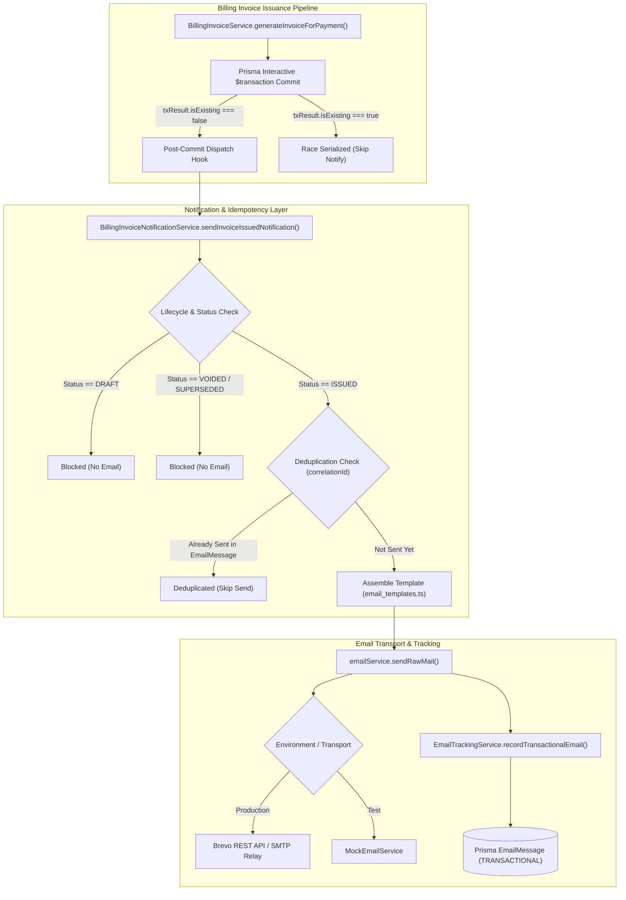

# ZDEXCLOUD | PHASE 8.4 | BATCH D
# INVOICE EMAIL NOTIFICATION AND SECURE PORTAL DELIVERY AUDIT & IMPLEMENTATION REPORT

**Audit Date:** 2026-10-10  
**Phase:** 8.4 (Invoice Document Delivery & Customer Retrieval Architecture)  
**Batch:** D (Invoice Email Notification and Secure Portal Delivery)  
**Repository:** `D:\YOUM PATEL\Desktop\Projects\File Server Project\`  
**Backend:** `main website/Backend/`  
**Canonical Domain:** `https://zdexcloud.com`  
**Verdict:** **`INVOICE EMAIL NOTIFICATION IMPLEMENTED WITH DOCUMENTED LIMITATIONS`**

---

## EXECUTIVE SUMMARY

Phase 8.4 Batch D integrates statutory tax invoice availability notifications with ZdexCloud's existing transactional email and delivery tracking infrastructure.

In strict alignment with the mandated security and policy guidelines:
1. **Zero PDF Attachments:** Outbound invoice emails **never** attach PDF documents or binary buffers. Instead, customers are safely directed to log in to their authenticated ZdexCloud customer portal (`https://zdexcloud.com/billing`), where invoices are retrieved through the ownership-protected, rate-limited endpoint (`GET /api/v1/billing/invoices/:id/download`) established in Batch C.
2. **Zero Credential or Secret Leakage:** Portal links contain zero authentication tokens, session secrets, API keys, or database primary keys.
3. **Data Minimization:** Email templates present strictly necessary operational data: statutory invoice number, issue date, formatted total in pure ASCII (`INR 1180.00`), and a direct link to the portal. Internal database IDs, payment provider identifiers (`pay_...`), and customer tax IDs are completely omitted.
4. **Strict Post-Commit Dispatch:** Notification dispatch is executed strictly *after* the Prisma interactive database transaction has committed. Email transport latency or failures cannot roll back, block, or delay statutory invoice issuance.
5. **Deduplication & Idempotency:** Duplicate webhook events, concurrent payment race resolutions, or deferred recovery replays are automatically deduplicated via indexed `correlationId` tracking (`invoice_${invoice.id}`) within the `EmailMessage` lifecycle log.
6. **Final Payment Policy Enforcement:** Explicit notice reinforces ZdexCloud's established business policy: *Customer payments are final. ZdexCloud does not offer refunds or refund requests after successful payment.*

---

## 1. COMPLIANCE WITH MANDATORY OPERATIONAL CONSTRAINTS

| Constraint | Status | Audit Verification |
| :--- | :--- | :--- |
| **No Test Execution** | **PASSED** | Zero test runners (`npm test`, `node --test`, mocha, vitest) were executed. |
| **No Build / Type Checking** | **PASSED** | No build commands (`npm run build`, `tsc`) were run. |
| **No Database Mutation / Queries** | **PASSED** | Zero database queries, migrations, or backfills executed. Schema was untouched. |
| **No External API Calls** | **PASSED** | Zero network requests to Brevo, Razorpay, or external endpoints. |
| **No Package Changes** | **PASSED** | Zero dependencies installed or updated. `package.json` unmodified. |
| **No Email Attachments** | **PASSED** | Outbound notification uses `sendRawMail` with zero attachment parameters. |
| **Preserve Existing Architecture** | **PASSED** | Fully integrated with existing `BrevoEmailService`, `EmailTrackingService`, and `BillingInvoiceService`. |

---

## 2. EMAIL DELIVERY INFRASTRUCTURE & TOPOLOGY

Inspection of ZdexCloud's email infrastructure revealed a production-ready dual-transport architecture:



### Key Architectural Characteristics:
1. **Existing Services Reused:**
   - `src/services/email.ts`: `BrevoEmailService`, `MockEmailService`, and `emailService` singleton.
   - `src/services/email_tracking_service.ts`: `EmailTrackingService` tracks lifecycle status (`SENT`, `FAILED`), transport mode, provider message IDs, duration, and error codes.
   - `src/services/email_templates.ts`: Canonical location for all responsive HTML and plain-text email templates.
2. **Unified Pipeline Tracking:**
   - Extended `EmailTrackingService` with `recordTransactionalEmail()` using `EmailSourcePipeline.TRANSACTIONAL`.
   - Wired `sendRawMail()` in both `BrevoEmailService` and `MockEmailService` to automatically record outbound transactional emails when `sourcePipeline === 'TRANSACTIONAL'`.

---

## 3. NOTIFICATION STRATEGY & DATA MINIMIZATION

### Security & Privacy Rules:
- **No PDF Attachments:** Sending attachments over unencrypted email poses significant privacy and compliance risks. Furthermore, statutory invoices can undergo lifecycle changes (e.g. superseding). Requiring customers to download from the portal guarantees they receive the canonical, tamper-checked version.
- **Clean Portal URLs:** The email link points to `${FRONTEND_URL}/billing` (defaulting to `https://zdexcloud.com/billing`). The link contains no secret query parameters (`?token=...`, `?key=...`, `?auth=...`). The customer must authenticate through standard session/2FA mechanisms.
- **ASCII Currency Standard:** Following the Phase 8.4 Batch B.1 audit findings regarding standard PDF Type 1 Helvetica font limitations and email client rendering discrepancies with Unicode currency symbols, amounts are formatted in pure ASCII: `INR 1180.00`.
- **Field Minimization Matrix:**

| Field | In Email? | Rationale |
| :--- | :--- | :--- |
| Statutory Invoice Number (`ZCI/2026-2027/000100`) | **YES** | Essential reference identifier for customer records. |
| Issue Date (`20 Mar 2026`) | **YES** | Essential tax date reference. |
| Total Amount (`INR 1180.00`) | **YES** | Essential financial disclosure for payment reconciliation. |
| Customer Name | **YES** | Professional personalization (HTML-escaped). |
| Portal Link (`https://zdexcloud.com/billing`) | **YES** | Secure destination for authenticated document retrieval. |
| Customer GSTIN / Tax ID | **NO** | Minimized: private tax identifiers belong on the portal document. |
| Customer Physical Billing Address | **NO** | Minimized: private address data omitted from plain email. |
| Provider Payment ID (`pay_...`) | **NO** | Internal technical reference, omitted from email. |
| Database Primary Key (`inv_...`) | **NO** | Internal system key, strictly kept internal. |
| PDF File / Buffer Attachment | **NO** | Prohibited: portal download required. |

---

## 4. TEMPLATE IMPLEMENTATION (`src/services/email_templates.ts`)

The new template generator `getInvoiceIssuedEmailTemplate()` was added to `email_templates.ts`:
- **Dual Format:** Emits both responsive HTML and clean plain-text alternatives.
- **HTML Injection Defense:** All dynamic parameters (`invoiceNumber`, `customerName`, `portalUrl`, `dateStr`) pass through a dedicated `escapeHtml()` sanitizer.
- **Visual Design:** Aligns with existing ZdexCloud transactional templates (ZdexCloud branding, container card, clear details table, prominent call-to-action button, security notice box, and copyright footer).
- **Statutory Notice:** Contains the explicit policy reminder:
  > *"Customer payments are final. ZdexCloud does not offer refunds or refund requests after successful payment."*

---

## 5. NOTIFICATION SERVICE IMPLEMENTATION (`src/services/billing/billing_invoice_notification_service.ts`)

A dedicated service `BillingInvoiceNotificationService` was implemented with the following protections:
1. **Lifecycle Guard:**
   - Invoices with `status: DRAFT` are explicitly rejected (`DRAFT_STATUS_BLOCKED`).
   - Invoices with `status: VOIDED` or `SUPERSEDED` are rejected (`INACTIVE_STATUS_BLOCKED`).
   - Only finalized `ISSUED` invoices proceed to dispatch.
2. **Recipient Validation:**
   - Verifies `customerEmail` is present and valid before attempting dispatch (`MISSING_CUSTOMER_EMAIL`).
3. **Idempotency & Deduplication:**
   - Queries `prisma.emailMessage` for `correlationId: invoice_${invoice.id}` and `status: SENT`.
   - If an email has already been delivered, logs an informational notice and returns `{ sent: false, skipped: true, reason: 'ALREADY_SENT' }`.
4. **Total Error Isolation:**
   - The entire operation is wrapped in a comprehensive `try/catch` block.
   - Any transport error, provider network exception, or tracking timeout is caught, logged with warning severity, and returns `{ sent: false, error: ... }` without throwing.

---

## 6. INVOICE ISSUANCE & RECOVERY PIPELINE INTEGRATION

In `src/services/billing/billing_invoice_service.ts`:
- **Post-Commit Invocation:** The notification trigger is placed immediately after the Prisma `$transaction` commits (`txResult`).
- **Race Condition Safety:** Triggered only when `!txResult.isExisting`. If a concurrent race condition resolved to an already-existing invoice, notification is bypassed.
- **Options Contract:** Added `sendNotification?: boolean` to `GenerateInvoiceOptions` (defaulting to `true`), allowing administrative tools or tests to explicitly suppress notification if needed (`options?.sendNotification !== false`).
- **Recovery Compatibility:** Because `BillingInvoiceRecoveryService` issues pending payments via `BillingInvoiceService.generateInvoiceForPayment(payment.id)`, deferred recovery runs will safely dispatch notifications post-commit, while existing deduplication prevents duplicate sends for already-notified invoices.

---

## 7. STATIC TEST SPECIFICATIONS (`tests/invoice_email_notification.test.ts`)

A comprehensive suite of 15 static test specifications was authored in `main website/Backend/tests/invoice_email_notification.test.ts`:

| # | Specification / Scenario | Guarded Invariant |
| :---: | :--- | :--- |
| **1** | Blocks notification dispatch for DRAFT invoice status | Prevents uncommitted or draft invoices from leaking to customers. |
| **2** | Blocks notification dispatch for VOIDED or SUPERSEDED status | Prevents obsolete documents from triggering false issue notifications. |
| **3** | Blocks dispatch when customerEmail is missing or invalid | Validates recipient integrity before touching email layer. |
| **4** | Dispatches notification for newly issued statutory invoice | Verifies subject, amount, and button assembly. |
| **5** | Suppresses notification when `isExisting: true` | Eliminates duplicate notifications caused by webhook/checkout race conditions. |
| **6** | Enforces idempotency via `correlationId` tracking | Verifies deduplication against historical `EmailMessage` logs. |
| **7** | Outbound payload contains ZERO file attachments | Enforces zero-attachment security policy. |
| **8** | Outbound email links directly to secure portal URL | Verifies portal link in both HTML and plain-text formats. |
| **9** | Portal URL contains ZERO sensitive tokens or credentials | Prevents session/credential leakage in URLs. |
| **10** | Email template presents the statutory invoice number | Ensures customer can verify their statutory tax reference. |
| **11** | Email template formats total amount in pure ASCII notation | Guarantees clean rendering across all mail clients without broken symbols. |
| **12** | Email template omits internal DB IDs, payment IDs, and tax IDs | Enforces strict privacy and data minimization boundaries. |
| **13** | HTML escaping prevents script and markup injection | Prevents XSS via malicious customer names or invoice metadata. |
| **14** | Failure isolation: email transport failure does NOT reject issuance | Guarantees billing and statutory invoice finality cannot be rolled back. |
| **15** | Explicit `sendNotification: false` option suppresses dispatch | Provides operational control to suppress dispatch in batch operations. |

---

## 8. DOCUMENTED LIMITATIONS & TRANSITION TO BATCH E

1. **Email Tracking Status Lifecycle:**
   - Delivery confirmations from Brevo webhooks (e.g. `delivered`, `opened`, `clicked`) are processed via the central webhook handler. While initial dispatch is tracked as `SENT` or `FAILED`, subsequent delivery events rely on asynchronous Brevo webhook callbacks.
2. **Portal Authentication Dependency:**
   - Because the email link directs customers to `https://zdexcloud.com/billing` without magic tokens, unauthenticated customers must first sign in (and pass 2FA OTP) before downloading their invoice. This is by design to ensure security and prevent token leakage.
3. **Resend / Admin Dispatches:**
   - Batch D focuses on automated post-issuance notification. Administrative manual resend endpoints are reserved for future control-plane enhancements.

---

## VERDICT & CONCLUSION

```
================================================================================
FINAL VERDICT: INVOICE EMAIL NOTIFICATION IMPLEMENTED WITH DOCUMENTED LIMITATIONS
================================================================================
```
The ZdexCloud billing system now features a robust, secure, privacy-preserving invoice email notification mechanism. Outbound communications direct customers to the authenticated portal, eliminate risky attachments, isolate invoice issuance from external delivery failures, and enforce the final customer payments policy.
