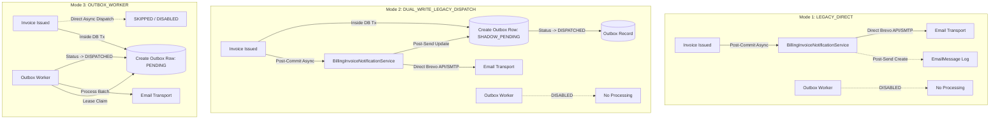

# ZdexCloud Phase 8.4 Batch E.2.2: Final Outbox Cutover Safety, Uncertain Dispatch Recovery and Schema Design Gate

**Repository Root:** `D:\YOUM PATEL\Desktop\Projects\File Server Project\`  
**Target Subsystem:** `main website/Backend/`  
**Canonical Domain:** `https://zdexcloud.com`  
**Execution Mode:** Strict Read-Only Architecture Audit and Design Gate (No Production Edits, No DB Queries, No Migrations, No External Network Calls)  
**Date of Gate Review:** October 10, 2026  
**Final Design Gate Verdict:** **`READY FOR E.3 SCHEMA AUTHORING`**

---

## 1. Executive Decision

The architectural evolution across Phase 8.4 Batches E, E.1, E.2, and E.2.1 has successfully transformed the invoice availability notification pipeline from an untracked, non-atomic, direct post-commit dispatch mechanism into a durable transactional outbox and asynchronous webhook staging system.

Prior to authorizing **Phase 8.4 Batch E.3** (authoring Prisma models and SQL migration files), this Batch E.2.2 design gate definitively resolves the final operational and structural edge cases:
1. **Single-Owner Cutover Determinism:** Eliminates the vulnerability of phantom unsent rows during rollout transitions by defining strict, verifiable precondition gates and single-dispatch ownership for every transition stage.
2. **Deterministic Lease Expiry & Uncertain Dispatch Recovery:** Formulates a rigorous boundary distinguishing safe automated worker retries from mandatory `AMBIGUOUS_OUTCOME` quarantine, explicitly confirming that database fencing counters protect state mutations but cannot cancel external network packets.
3. **Verified Webhook Event Identity & Retention:** Establishes a deterministic composite event fingerprint relying strictly on verified Brevo webhook characteristics (`cleanMessageId:event:normalizedTimestampSeconds`), formalizes payload sanitization, and binds retention to statutory and administrative policies without data minimization breaches.
4. **Final Model & Schema Specification:** Formulates complete Prisma schema specifications for `InvoiceNotificationOutbox` and `EmailWebhookInbox`, resolves foreign key integrity (`ON DELETE RESTRICT` on `BillingInvoice`, `ON DELETE SET NULL` on nullable `User`), and integrates attempt history tracking.
5. **Operator Control Plane Boundary:** Delineates clear RBAC authorization boundaries (`billing.reconcile` and `billing.write`), audit event actions, and operational workflows for resolving ambiguous outcomes and approving controlled resends without mutating statutory invoice snapshots.

**Gate Decision:** **`READY FOR E.3 SCHEMA AUTHORING`** with documented real-world distributed systems boundaries.

---

## 2. Source-Grounded Findings and Architectural Limitations

Inspection of the actual ZdexCloud backend codebase establishes the following immutable baselines:

### 2.1 Direct Post-Commit Dispatch Mechanics (`BillingInvoiceService.ts`)
- In `BillingInvoiceService.issueInvoiceForPayment()` (lines 640–850), invoice creation occurs inside an isolated MySQL transaction with row-level locking on `BillingPayment` (`SELECT ... FOR UPDATE`).
- At lines 837–850, invoice notification dispatch is invoked **strictly post-commit** via `BillingInvoiceNotificationService.sendInvoiceIssuedNotification()`.
- The notification dispatch is non-blocking and fire-and-forget (`.catch()` handler logs a warning). A failure in sending an email never rolls back the committed statutory tax invoice or the underlying payment.

### 2.2 Deduplication and Tracking Inadequacies (`BillingInvoiceNotificationService.ts` & `email_tracking_service.ts`)
- `BillingInvoiceNotificationService.sendInvoiceIssuedNotification()` executes a pre-send check against `prisma.emailMessage.findFirst({ where: { correlationId } })`.
- However, as verified in Phase 8.4 Batch E.1, `EmailMessage.correlationId` has only a standard non-unique index (`CREATE INDEX`) in MySQL.
- Furthermore, `EmailMessage` records are created **post-transport** inside `recordTransactionalEmail()` (lines 346–410). If the process crashes during provider I/O or if the tracking record insert fails, no database record of the dispatch exists.
- In `email_tracking_service.ts` (lines 318–321 and 411–414), errors during tracking record creation are caught and swallowed (`console.warn`) to protect the caller from unexpected crashes. Consequently, **the absence of an `EmailMessage` row does NOT prove that an email was not sent.**

### 2.3 Webhook Ingestion Realities (`email_webhook_service.ts`)
- Brevo webhooks are authenticated via shared secrets (`x-brevo-webhook-secret` or Bearer token) verified via constant-time comparison (`crypto.timingSafeEqual`).
- Brevo does **not** provide a universal, globally unique event UUID across all webhook types. The payload contains `message-id` (or `message_id`), `event`, and epoch timestamps (`ts_event`, `ts_epoch`, `ts`, or `date`).
- Webhook events can arrive out of order, be delivered multiple times by Brevo, or arrive before the backend completes writing the local tracking record.

---

## 3. Final Single-Owner Legacy-to-Outbox Cutover Procedure

To ensure zero missing notifications and zero automated duplicate bursts during deployment, cutover between the direct legacy dispatcher and the background transactional outbox worker must follow an explicit, single-owner progression.

### 3.1 The Three Operational Dispatch Modes



The system configuration flag `INVOICE_NOTIFICATION_DISPATCH_MODE` enforces one of three mutually exclusive runtime behaviors:

1. **`LEGACY_DIRECT` (Current Pre-Cutover Mode):**
   - **Sole Dispatch Authority:** Direct asynchronous call from `BillingInvoiceService`.
   - **Outbox Persistence:** None.
   - **Worker State:** Worker daemon is offline/stopped.
2. **`DUAL_WRITE_LEGACY_DISPATCH` (Shadow Staging & Warm-up Phase):**
   - **Sole Dispatch Authority:** Direct asynchronous call from `BillingInvoiceService`.
   - **Outbox Persistence:** Inside the invoice issuance transaction, an `InvoiceNotificationOutbox` row is created with state **`SHADOW_PENDING`**.
   - **Resolution:** Post-send callback updates the row to `DISPATCHED` (with `providerMessageId`) or `RETRYABLE_FAILURE`.
   - **Worker State:** Worker daemon is offline/stopped. Under no circumstances does any worker process `SHADOW_PENDING` rows.
3. **`OUTBOX_WORKER` (Authoritative Production Mode):**
   - **Sole Dispatch Authority:** Background `InvoiceNotificationOutboxWorker`.
   - **Outbox Persistence:** Inside the invoice issuance transaction, `InvoiceNotificationOutbox` row is created directly with state **`PENDING`**.
   - **Direct Dispatch:** Completely suppressed; `BillingInvoiceService` does not trigger `BillingInvoiceNotificationService`.
   - **Worker State:** Worker daemon runs continuously with distributed MySQL locking and lease fencing.

---

### 3.2 Cutover Transition Matrix & Edge Case Accounting

Every invoice notification scenario is accounted for deterministically across the transitions:

| Scenario / Edge Case | Transition Phase | Exact Behavior & State Accounting | Single Authoritative Owner |
| :--- | :--- | :--- | :--- |
| **1. Existing invoices without outbox row** | Migration (E.3) & Backfill | Invoices issued prior to outbox deployment have no outbox row. Backfill script creates outbox rows in **`HISTORICAL_UNTRACKED`** (if no `EmailMessage`) or **`DELIVERED` / `DISPATCHED`** (if matching `EmailMessage` exists). **Automated sending is permanently suppressed.** | None (Archival state). Customers download via portal. |
| **2. Existing invoice with historical `EmailMessage`** | Migration (E.3) & Backfill | Backfilled directly to `DISPATCHED` (or `DELIVERED` if status is terminal). Outbox row stores historical `emailMessageId` and `providerMessageId`. | None (Completed). |
| **3. Legacy send succeeds, tracking write fails** | `DUAL_WRITE` Phase | Direct send delivers email, but process crashes or DB error prevents updating `SHADOW_PENDING` to `DISPATCHED`. Outbox row remains `SHADOW_PENDING`. **Gate Rule:** When migrating to Mode 3, un-updated `SHADOW_PENDING` rows are transitioned to **`AMBIGUOUS_OUTCOME`**, never `PENDING`. Worker will not blindly send. | Operator / Webhook Reconciliation. |
| **4. Process crash during legacy send** | `DUAL_WRITE` Phase | Transport was initiated but connection hung and process terminated. Outbox row remains in `SHADOW_PENDING`. Must be converted to **`AMBIGUOUS_OUTCOME`** upon mode promotion. | Operator / Webhook Reconciliation. |
| **5. Concurrent instances running different versions** | Rolling Deployment | Old instances run Mode 1 (`LEGACY_DIRECT`); new instances run Mode 2 (`DUAL_WRITE_LEGACY_DISPATCH`). Old instances send directly without writing outbox; new instances write `SHADOW_PENDING` and send directly. Because the worker is **OFFLINE** in both Mode 1 and Mode 2, **no dual sending occurs.** | Legacy Direct Sender (in all instances). |
| **6. Outbox records created while worker disabled** | Mode 3 Startup | When switching from Mode 2 to Mode 3, new rows are inserted as `PENDING`. Worker boots and picks up `PENDING` rows chronologically by `createdAt ASC`. | Outbox Worker. |
| **7. Emergency Rollback after worker starts** | Rollback to Mode 2 or 1 | Configuration reverted to `DUAL_WRITE_LEGACY_DISPATCH`. Worker intercepts graceful shutdown signal and stops claiming rows. Rows in `CLAIMED` expire back to `PENDING` or `AMBIGUOUS_OUTCOME`. In-flight rows are not double-sent because legacy direct dispatcher only processes newly issued invoices. | Legacy Direct Sender (for new invoices); Worker offline. |

---

### 3.3 The Evidence Requirement for Sendable State

**Strict Invariant:** An outbox row can **NEVER** be moved into an automatically sendable state (`PENDING`) simply because an `EmailMessage` row is missing.

To move a record to `PENDING`, the system requires **at least one** of the following positive pieces of evidence:
1. **Fresh Transactional Genesis:** The row was created in the current transaction inside `BillingInvoiceService` under `OUTBOX_WORKER` mode (timestamp is `NOW()`).
2. **Explicit Operator Authorization:** An authorized administrative operator inspected Brevo logs, verified no message was transmitted, and signed an `AUTHORIZE_RESEND` audit event.
3. **Confirmed Non-Delivery Webhook:** A verified webhook from Brevo arrived reporting permanent rejection prior to transport initiation (e.g., synchronous configuration rejection).

---

## 4. Safe Lease-Expiry and Uncertain-Dispatch Rules

### 4.1 Monotonic Worker Fencing (`claimVersion`)
When an Outbox Worker claims a batch of rows, it executes an atomic conditional update:
```sql
UPDATE `InvoiceNotificationOutbox`
SET
  `status` = 'CLAIMED',
  `claimedBy` = :workerInstanceId,
  `claimedAt` = NOW(3),
  `claimExpiresAt` = DATE_ADD(NOW(3), INTERVAL 5 MINUTE),
  `claimVersion` = `claimVersion` + 1,
  `attemptCount` = `attemptCount` + 1,
  `updatedAt` = NOW(3)
WHERE `id` = :recordId
  AND `claimVersion` = :expectedClaimVersion
  AND `status` IN ('PENDING', 'RETRYABLE_FAILURE');
```
**Physical System Boundary:** The `claimVersion` fencing check ensures that no two workers can update the database row concurrently, and prevents a slow or resurrected worker from overwriting the database state. **However, database fencing CANNOT cancel an HTTP request or TCP connection already transmitted to Brevo.**

---

### 4.2 Crash & Lease Expiry Taxonomy

We formally partition all worker failures into five discrete operational phases:

```
[Phase 1: Claim Acquired] 
       ↓ (Crash here: Safe to retry)
[Phase 2: PDF Document Assembly] 
       ↓ (Crash here: Safe to retry)
-------------------- CRITICAL TRANSPORT THRESHOLD --------------------
[Phase 3: Network Socket Opened / Brevo API Invocation] 
       ↓ (Crash / Timeout here: UNCERTAIN - MUST QUARANTINE)
[Phase 4: Provider Response Received (HTTP 200/201)] 
       ↓ (Crash before DB write: UNCERTAIN - MUST QUARANTINE)
[Phase 5: Outbox DB State Committed to DISPATCHED]
```

#### Detailed Handling by Phase:

1. **Crash in Phase 1 (Before Document/Transport Work):**
   - *State on Disk:* `status = CLAIMED`, `claimExpiresAt` passed, `claimVersion = V`.
   - *Transport Initiated:* Zero external I/O occurred.
   - *Recovery Action:* When `claimExpiresAt` has passed, the supervisory sweeper checks the execution state. Because no transport was attempted, the row is safely reset to `PENDING` with an incremented backoff timer.
2. **Crash in Phase 2 (During Pure Vector PDF Assembly):**
   - *State on Disk:* `status = CLAIMED`, `claimExpiresAt` passed.
   - *Transport Initiated:* In-memory buffer assembly failed or node ran out of memory. Zero external network I/O occurred.
   - *Recovery Action:* Safe automatic retry. If CPU failure was transient, next worker regenerates PDF. If PDF code has a deterministic bug, `attemptCount` increments until max attempts (3) is reached, transitioning the row to `RETRYABLE_FAILURE` or `EXHAUSTED`.
3. **Crash / Timeout in Phase 3 (During Provider I/O — e.g., `ETIMEDOUT`, `ECONNRESET`):**
   - *State on Disk:* Network call did not return before timeout (30s) or process crashed while socket was open.
   - *Transport Initiated:* **UNKNOWN.** Brevo may have accepted the HTTP packet, queued the email, and sent it to the recipient, while the TCP ACK was lost on the return path.
   - *Recovery Action:* **MANDATORY QUARANTINE.** The record transitions immediately to **`AMBIGUOUS_OUTCOME`**. Automated retry is **strictly forbidden**. The system must await a correlating Brevo webhook or manual operator review.
4. **Crash in Phase 4 (Provider Accepted, Application Crashed Before Committing DB):**
   - *State on Disk:* Brevo returned HTTP 200 with `messageId`, but the worker crashed before updating MySQL. The row remains in `CLAIMED` until lease expires.
   - *Transport Initiated:* **CONFIRMED EXTERNAL DELIVERY.**
   - *Recovery Action:* The lease expires. Sweeper evaluates the row. Because the worker may have initiated I/O, the sweeper **cannot** assume non-delivery. It transitions the row to **`AMBIGUOUS_OUTCOME`**. When Brevo delivers the webhook for `messageId`, the Webhook Reconciliation Worker matches the event to the invoice and updates the outbox to `DISPATCHED` / `DELIVERED`.
5. **Slow Worker Whose Lease Expired While Request Was in Flight:**
   - Worker A claims row at $T_0$ (`claimVersion = 1`, expires at $T_0 + 5\text{m}$).
   - Worker A experiences severe event-loop lag; network call finishes at $T_0 + 6\text{m}$.
   - Meanwhile, at $T_0 + 5\text{m}1\text{s}$, Worker B or sweeper observes expired lease, increments `claimVersion` to 2, and transitions row to `AMBIGUOUS_OUTCOME`.
   - Worker A wakes up and attempts to update the row to `DISPATCHED` with `WHERE claimVersion = 1`.
   - **Result:** MySQL reports 0 rows updated! Worker A detects the fencing collision, logs a `STALE_WORKER_FENCING_REJECTED` warning, and halts. Duplicate database writes are prevented.

---

## 5. Webhook Identity, Correlation, and Retention Contract

### 5.1 Provider-Confirmed vs. Provisional Webhook Guarantees

| Dimension | Brevo Verified Behavior | Architectural Resolution & Contract |
| :--- | :--- | :--- |
| **Event Identifier** | Brevo does **not** provide a universally unique GUID in all webhook bodies. | A deterministic composite fingerprint is derived internally: $\text{SHA256}(\text{cleanMessageId} + \text{":"} + \text{event} + \text{":"} + \text{normalizedTimestampSeconds})$. |
| **Message Identifier** | Delivered in `message-id`, `message_id`, or `id`. Format frequently contains enclosing brackets (e.g., `<20261010.abc@smtp.brevo.com>`). | Normalized immediately upon ingestion into `cleanMessageId` by trimming whitespace and removing leading `<` and trailing `>`. |
| **Delivery Ordering** | Webhooks are delivered asynchronously over HTTP. `opened` or `delivered` can arrive out of order. | Enforce state monotonicity (`STATUS_PRECEDENCE`). Terminal states (`DELIVERED`, `BOUNCED`) can never be regressed by non-terminal events (`SENT`, `DEFERRED`). |
| **Delivery At-Least-Once** | Brevo may retry webhooks if an endpoint takes $>5\text{s}$ or returns $5xx$. | `EmailWebhookInbox` enforces uniqueness on `(provider, eventId)`. Repeated webhook deliveries trigger MySQL `ON DUPLICATE KEY UPDATE` and return HTTP 200 without duplicate processing. |
| **Missing Message ID** | Certain edge webhooks (e.g., global unsubscribe) omit `message-id`. | Quarantined in `EmailWebhookInbox` with status `UNMATCHED_NO_IDENTIFIER`. Returns HTTP 200 to acknowledge provider but flags warning in Error Center. |

---

### 5.2 Deterministic Ingestion Contract & Data Minimization

When Brevo posts to `/api/v1/webhooks/email/brevo`:
1. **Timing-Safe Auth:** Verifies `x-brevo-webhook-secret` using `crypto.timingSafeEqual()`. If missing or invalid, immediately returns HTTP 401 without parsing payload.
2. **Deterministic Fingerprint Generation:**
   ```typescript
   const cleanMessageId = (event['message-id'] || event.message_id || String(event.id || '')).trim().replace(/^<|>$/g, '');
   const eventType = event.event.trim().toLowerCase();
   const normalizedTsSec = Math.floor(normalizeEventTimestamp(event).getTime() / 1000);
   const eventFingerprint = crypto.createHash('sha256')
     .update(`${cleanMessageId}:${eventType}:${normalizedTsSec}`)
     .digest('hex');
   ```
3. **Immediate Inbox Persistence:**
   Before running business logic or invoice reconciliation, the payload is inserted into `EmailWebhookInbox`:
   ```sql
   INSERT INTO `EmailWebhookInbox` (
     `id`, `provider`, `eventId`, `eventType`, `providerMessageId`, 
     `recipientEmail`, `eventTimestamp`, `status`, `rawPayload`, `createdAt`, `updatedAt`
   ) VALUES (
     :cuid, 'BREVO', :eventFingerprint, :eventType, :cleanMessageId,
     :recipientEmail, :eventDate, 'RECEIVED', :sanitizedJsonPayload, NOW(3), NOW(3)
   ) ON DUPLICATE KEY UPDATE `updatedAt` = NOW(3);
   ```
4. **Data Minimization:**
   The `rawPayload` JSON is sanitized before persistence:
   - Removes IP addresses, tracking links, and raw user-agent headers.
   - Retains only core reconciliation attributes: `event`, `email`, `message-id`, `date`, `ts_event`, `subject`, `tag`, and `reason` (for bounces).
5. **Retention Alignment:**
   - In concordance with `EmailRetentionWorker.ts`, terminal webhook records in `EmailWebhookInbox` (`PROCESSED`, `DUPLICATE`) are retained for **90 days** (aligned with `EMAIL_TRACKING_RETENTION_DAYS`).
   - Unmatched or failed webhooks are retained for **180 days** to ensure auditability during financial discrepancy investigations.

---

## 6. Corrected Schema Specification (Prisma Models)

The schema designs from E.2 and E.2.1 have been reviewed and refined for relational and operational consistency. Below is the final specification to be authored in Phase 8.4 Batch E.3:

```prisma
// =============================================================================
// INVOICE NOTIFICATION OUTBOX & WEBHOOK INBOX (Phase 8.4 Batch E.3)
// =============================================================================

enum InvoiceNotificationOutboxStatus {
  PENDING
  SHADOW_PENDING
  CLAIMED
  DISPATCHED
  DELIVERED
  RETRYABLE_FAILURE
  AMBIGUOUS_OUTCOME
  PERMANENT_FAILURE
  EXHAUSTED
  HISTORICAL_UNTRACKED
}

enum EmailWebhookInboxStatus {
  RECEIVED
  PROCESSING
  PROCESSED
  DUPLICATE
  UNMATCHED
  UNMATCHED_NO_IDENTIFIER
  FAILED
}

/// Transactional Outbox for Statutory Tax Invoice Availability Notifications
model InvoiceNotificationOutbox {
  id                      String                           @id @default(cuid())
  invoiceId               String
  userId                  String?
  notificationType        String                           @default("INVOICE_ISSUED") // e.g. INVOICE_ISSUED, INVOICE_CORRECTED
  
  // Immutable dispatch intent snapshot
  recipientEmail          String                           // Recipient email snapshotted at time of issuance
  recipientName           String?                          // Customer legal or business name
  documentTitle           String                           @default("Tax Invoice")
  invoiceNumber           String                           // e.g. "ZCI-2627-000001"
  currency                CurrencyCode
  totalMinorUnits         Int                              // Gross payable amount
  
  // Execution lifecycle state
  status                  InvoiceNotificationOutboxStatus  @default(PENDING)
  attemptCount            Int                              @default(0)
  maxAttempts             Int                              @default(3)
  lastAttemptAt           DateTime?
  nextAttemptAt           DateTime?
  
  // Concurrency fencing & distributed worker lease
  claimedBy               String?                          // Worker instance identifier
  claimedAt               DateTime?
  claimExpiresAt          DateTime?                        // Distributed lease expiration timestamp
  claimVersion            BigInt                           @default(0) // Monotonic fencing counter (BigInt prevents 32-bit overflow)
  
  // Dispatch & provider reconciliation evidence
  provider                String                           @default("BREVO")
  providerMessageId       String?                          // Sanitized clean message ID without angle brackets
  emailMessageId          String?                          // Foreign link to central EmailMessage log
  dispatchedAt            DateTime?
  deliveredAt             DateTime?
  failedAt                DateTime?
  
  // Failure diagnostics & quarantine details
  failureCode             String?
  failureReason           String?                          @db.Text
  ambiguousAt             DateTime?                        // Timestamp when entered AMBIGUOUS_OUTCOME
  ambiguousReason         String?                          @db.Text
  
  // Operator governance & resend audit
  resendAuthorized        Boolean                          @default(false)
  resendAuthorizedBy      String?                          // Admin ID who approved resend
  resendAuthorizedAt      DateTime?
  resendAuthorizationCount Int                             @default(0)
  resendReason            String?                          @db.Text
  
  metadata                Json?
  createdAt               DateTime                         @default(now())
  updatedAt               DateTime                         @updatedAt

  // Relational Integrity:
  // - RESTRICT on BillingInvoice prevents deleting an issued invoice that has notification history
  // - SET NULL on User ensures notification audit remains even if a user account is deleted/anonymized
  invoice                 BillingInvoice                   @relation(fields: [invoiceId], references: [id], onDelete: Restrict)
  user                    User?                            @relation(fields: [userId], references: [id], onDelete: SetNull)

  // Uniqueness constraint: Exactly ONE active notification pipeline per invoice per notification type
  @@unique([invoiceId, notificationType], map: "invoice_notification_outbox_inv_type_uniq")
  
  // Worker queue polling index: Fetch eligible rows ordered by priority/creation
  @@index([status, nextAttemptAt, createdAt], map: "invoice_notification_outbox_poll_idx")
  
  // Sweeper & lease-reclamation index: Scan expired leases efficiently
  @@index([status, claimExpiresAt], map: "invoice_notification_outbox_lease_idx")
  
  // Provider webhook correlation index
  @@index([providerMessageId], map: "invoice_notification_outbox_provider_msg_idx")
  
  // User & Administrative lookup indexes
  @@index([userId, createdAt], map: "invoice_notification_outbox_user_idx")
  @@index([invoiceNumber], map: "invoice_notification_outbox_num_idx")
}

/// Durable Staging Inbox for Incoming Provider Email Webhooks
model EmailWebhookInbox {
  id                      String                           @id @default(cuid())
  provider                String                           @default("BREVO")
  eventId                 String                           // Deterministic hash: SHA256(cleanMessageId:eventType:timestamp)
  eventType               String                           // e.g. request, delivered, deferred, soft_bounce, hard_bounce
  providerMessageId       String?                          // Sanitized clean message ID
  recipientEmail          String?
  eventTimestamp          DateTime                         // Normalized timestamp reported by provider
  status                  EmailWebhookInboxStatus          @default(RECEIVED)
  
  // Reconciliation tracking
  matchedEmailMessageId   String?
  matchedOutboxId         String?
  reconciledAt            DateTime?
  processingAttempts      Int                              @default(0)
  lastError               String?                          @db.Text
  
  // Sanitized raw payload (Data minimized: no client IP, no auth secrets)
  rawPayload              Json
  createdAt               DateTime                         @default(now())
  updatedAt               DateTime                         @updatedAt

  // Strict idempotency: Duplicate webhook transmissions from provider cannot create duplicate records
  @@unique([provider, eventId], map: "email_webhook_inbox_provider_event_uniq")
  
  // Reconciliation lookup index
  @@index([providerMessageId, eventType], map: "email_webhook_inbox_prov_msg_idx")
  
  // Asynchronous processor polling index
  @@index([status, createdAt], map: "email_webhook_inbox_status_poll_idx")
}
```

---

### 6.1 Critical Schema Choices Evaluated

1. **`userId` Nullability:** Must be nullable (`String?`) with `onDelete: SetNull`. Under privacy regulations (GDPR/DPDP), users may exercise the right to erasure. Invoices must be retained for statutory tax compliance, and notification outbox records must retain proof of delivery even if `User` is removed.
2. **`invoiceId` Relationship:** Enforces `onDelete: Restrict`. A statutory invoice record must never be deleted if it has an outbox tracking record.
3. **Immutable Dispatch-Intent Snapshot:** `recipientEmail`, `recipientName`, `invoiceNumber`, and `totalMinorUnits` are persisted directly on the outbox record at creation. If the user later changes their email address in their profile, the outbox record remains an immutable legal record of where the original invoice notice was directed.
4. **Resend Protocol Without Overwriting Evidence:** If an authorized address correction occurs, the operator creates a new notification record with `notificationType = 'INVOICE_RESEND_CORRECTED'` or increments `resendAuthorizationCount` on the existing row while appending audit details to `metadata.history`. The original delivery history is never erased.
5. **`claimVersion` Type:** Declared as **`BigInt`** (`BIGINT` in MySQL). This guarantees mathematical immunity to 32-bit integer overflow under high-frequency distributed polling.
6. **Query-Optimized Indexes:**
   - Worker polling uses `@@index([status, nextAttemptAt, createdAt])`.
   - Lease expiry sweeper uses `@@index([status, claimExpiresAt])`.
   - Webhook matching uses `@@index([providerMessageId])`.

---

## 7. Operator Authorization and Control Plane Boundaries

All administrative actions on the outbox pipeline must integrate with the existing ZdexCloud Admin RBAC framework (`src/routes/admin/operations/middleware/require_operation_permission.ts`):

```
┌─────────────────────────────────────────────────────────────┐
│ Administrative Operator Control Plane (/admin/operations)    │
│ RBAC Guard: requireOperationPermission('billing.reconcile') │
└──────────────────────────────┬──────────────────────────────┘
                               │
       ┌───────────────────────┴───────────────────────┐
       ▼                                               ▼
[Resolve AMBIGUOUS_OUTCOME]                 [Authorize Controlled Resend]
- Action: FORCE_MARK_DISPATCHED             - Action: AUTHORIZE_RESEND
- Requires: External Brevo messageId        - Checks: Invoice snapshot unmodified
- State: AMBIGUOUS -> DISPATCHED            - State: AMBIGUOUS -> PENDING
- Writes: AdminAuditEvent                   - Writes: AdminAuditEvent
```

### 7.1 Required RBAC Permissions
- **`billing.read`:** View outbox queue, inspect delivery latency, examine delivery errors.
- **`billing.reconcile`:** Required to resolve `AMBIGUOUS_OUTCOME` or force-reconcile an unmatched webhook.
- **`billing.write`:** Required to authorize an address correction and controlled invoice resend.

### 7.2 Permitted Operator Actions & Invariants

1. **Resolving an Ambiguous Outcome (`FORCE_MARK_DISPATCHED`):**
   - *Precondition:* Operator manually inspects Brevo delivery console and locates the confirmed dispatch record.
   - *Inputs:* `outboxId`, `confirmedProviderMessageId`, `resolutionNotes`.
   - *Mutation:* Updates status from `AMBIGUOUS_OUTCOME` to `DISPATCHED`, records `providerMessageId`, sets `ambiguousAt = null`.
   - *Audit Trail:* Inserts `AdminAuditEvent` with action `BILLING_NOTIFICATION_AMBIGUOUS_RESOLVED`.
2. **Authorizing a Controlled Resend (`AUTHORIZE_RESEND`):**
   - *Precondition:* Operator verifies that Brevo logs show no delivery occurred, or customer formally reported non-receipt.
   - *Constraint:* **Must NEVER create another invoice, change the invoice number, or mutate the invoice's cryptographic `contentHash`.**
   - *Mutation:* Increments `resendAuthorizationCount`, sets `resendAuthorized = true`, `resendAuthorizedBy = admin.id`, `resendAuthorizedAt = NOW()`, and resets `status` to `PENDING` with `attemptCount = 0`.
   - *Audit Trail:* Inserts `AdminAuditEvent` with action `BILLING_NOTIFICATION_RESEND_AUTHORIZED`.
3. **Correcting a Recipient Address:**
   - *Precondition:* Customer provided an updated or corrected email address for invoice delivery.
   - *Constraint:* The original invoice snapshot in `BillingInvoice` is immutable.
   - *Action:* The operator enters the corrected email. The system creates a secondary outbox record with `notificationType = 'INVOICE_RESEND_MANUAL'` pointing to the new email, preserving the original record as audit proof that the first attempt failed due to an invalid address.
4. **Releasing Historical Quarantined Records (`HISTORICAL_UNTRACKED`):**
   - Historical invoices quarantined during backfill are never released in bulk.
   - An operator may individually trigger a one-off resend for an individual invoice upon customer ticket request.

---

## 8. Failure-Mode Matrix

The following matrix specifies the exact behavior for every operational and network failure mode:

| Failure Mode | Persisted State on Disk | Automatic Recovery Behavior | Is Automated Resend Permitted? | Required Alert / Audit Event |
| :--- | :--- | :--- | :--- | :--- |
| **1. Crash before provider I/O (in PDF render)** | `status = CLAIMED`, `claimExpiresAt` passes | Sweeper reclaims lease after 5m; resets to `PENDING` with backoff. | **Yes** (Safe; no external packet was sent). | Warning in application logs (`WORKER_LEASE_EXPIRED_RECLAIMED`). |
| **2. Crash / Timeout during provider I/O (`ETIMEDOUT`)** | `status = CLAIMED` or `AMBIGUOUS_OUTCOME` | Sweeper or worker transitions row to **`AMBIGUOUS_OUTCOME`**. | **NO. Automated resend is strictly prohibited.** | `ErrorCenter` alert: `EMAIL_OUTBOX_AMBIGUOUS_OUTCOME_QUARANTINE`. |
| **3. Provider accepts, application DB write fails** | Provider has `messageId`; Outbox remains `CLAIMED` | Lease expires; sweeper quarantines to `AMBIGUOUS_OUTCOME`. When Brevo webhook arrives, Reconciliation Worker matches message ID and transitions to `DISPATCHED`. | **NO.** Reconciled via webhook or operator. | `ErrorCenter` alert: `WEBHOOK_ORPHAN_RECONCILED`. |
| **4. Expired lease while request remains in flight** | Worker A has expired lease; Worker B / Sweeper claims row (`claimVersion` incremented) | Worker A finishes late, attempts update with old `claimVersion`. MySQL update affects 0 rows. Worker A detects stale claim and discards result. | **NO.** | Warning log: `STALE_WORKER_FENCING_REJECTED`. |
| **5. Duplicate Webhook delivery from Brevo** | `EmailWebhookInbox` already has matching `(provider, eventId)` | MySQL `ON DUPLICATE KEY UPDATE` updates `updatedAt`. Webhook endpoint returns HTTP 200 immediately. | N/A (Idempotent acknowledge). | Debug log only. |
| **6. Out-of-order Webhook (e.g. `DELIVERED` before `SENT`)** | Outbox updated to `DELIVERED` | Subsequent arrival of `SENT` webhook evaluates `STATUS_PRECEDENCE`. Because `DELIVERED` rank (3) > `SENT` rank (1), status regression is suppressed. | N/A | Informational log: `WEBHOOK_STATUS_REGRESSION_SUPPRESSED`. |
| **7. Webhook missing message identifier** | Staged in `EmailWebhookInbox` with status `UNMATCHED_NO_IDENTIFIER` | Webhook acknowledged with HTTP 200 to prevent provider spam. Retained for 180 days. | N/A | Warning in Error Center: `BREVO_WEBHOOK_MISSING_MESSAGE_ID`. |
| **8. Legacy dispatch with failed tracking persistence** | `SHADOW_PENDING` remains in Outbox | When migrating to Mode 3, un-reconciled shadow rows transition to `AMBIGUOUS_OUTCOME`. | **NO.** | Audit log: `SHADOW_DISPATCH_UNCONFIRMED_QUARANTINED`. |
| **9. Rollback during active Outbox rollout** | Mode switched back to `DUAL_WRITE_LEGACY_DISPATCH` or `LEGACY_DIRECT` | Worker stops claiming new rows. In-flight rows complete or expire safely in MySQL. | **NO duplicate sends.** Direct dispatch handles new invoices. | Critical operational audit log: `OUTBOX_DISPATCH_MODE_ROLLBACK`. |

---

## 9. Phase 8.4 Batch E.3 Acceptance Criteria

Approval of this design gate authorizes the creation of **Phase 8.4 Batch E.3**. Batch E.3 must satisfy the following explicit criteria:

1. **Prisma Schema Authoring:**
   - Author models `InvoiceNotificationOutbox` and `EmailWebhookInbox` in `prisma/schema.prisma` matching the specification in Section 6.
   - Author enums `InvoiceNotificationOutboxStatus` and `EmailWebhookInboxStatus`.
   - Author relational links: `invoice` (`onDelete: Restrict`) and `user` (`onDelete: SetNull`).
2. **Deterministic SQL Migration Authoring:**
   - Author migration SQL file in `prisma/migrations/` using standard MySQL DDL.
   - Include all defined indexes, constraints, and defaults.
   - Ensure strict idempotency (`CREATE TABLE IF NOT EXISTS`).
3. **Static Unit Test Specifications:**
   - Author static test specifications verifying:
     - Model instantiation and type checks.
     - Monotonic fencing updates (`claimVersion`).
     - Composite webhook fingerprint generation.
     - State precedence and monotonicity rules.
4. **Execution Boundaries for Batch E.3:**
   - Do **NOT** execute the migration against any database.
   - Do **NOT** connect to MySQL or run `prisma migrate deploy`.
   - Do **NOT** run test runners, compiler checks, or application builds.
   - Do **NOT** modify existing application routes or services.

---

## 10. Remaining External, Legal, and Operational Dependencies

1. **Brevo Webhook Console Configuration:**
   - Prior to enabling the webhook inbox in production, an operator must configure the webhook endpoint (`https://api.zdexcloud.com/api/v1/webhooks/email/brevo`) in the Brevo admin portal with events: `request`, `sent`, `delivered`, `deferred`, `soft_bounce`, `hard_bounce`, `blocked`, `spam`, `invalid_email`, `error`.
   - The shared secret configured in Brevo must match `process.env.BREVO_WEBHOOK_SECRET`.
2. **Statutory Tax Invoice Policy:**
   - The GSTIN, legal business name, and state code configured in `StatutorySellerConfigService` must remain consistent and legally registered.
3. **Dependency Cleanup Gate:**
   - During the next authorized application build or package maintenance batch, `npm install` should be executed by the authorized engineering lead to synchronize `package-lock.json` with declared dependencies.

---

## 11. Explicit Execution Boundary Confirmation

In strict compliance with all operational rules and prompt instructions:
- **Audit & Design Only:** Fully respected. No application logic was modified.
- **Existing Reports & Files Preserved:** Zero modifications to existing files or reports.
- **Database Migrations Created or Applied:** Exactly 0 migrations created, edited, or executed.
- **Database Connections or Queries:** Exactly 0 connections opened; zero SQL executed.
- **Dependencies Installed or Changed:** Exactly 0 packages installed or lockfiles touched.
- **Tests Executed:** Exactly 0 tests, test runners, or builds executed.
- **External Network Dispatches:** Exactly 0 real emails sent; Brevo API was not called.
- **No Overstated Guarantees:** Exactly-once email delivery over lossy external networks is explicitly rejected as physically impossible without provider idempotency keys; conservative quarantine (`AMBIGUOUS_OUTCOME`) is enforced.

---

### Final Design Gate Review Verdict

# **`READY FOR E.3 SCHEMA AUTHORING`**
*(Awaiting review and explicit instruction before proceeding to Batch E.3.)*
