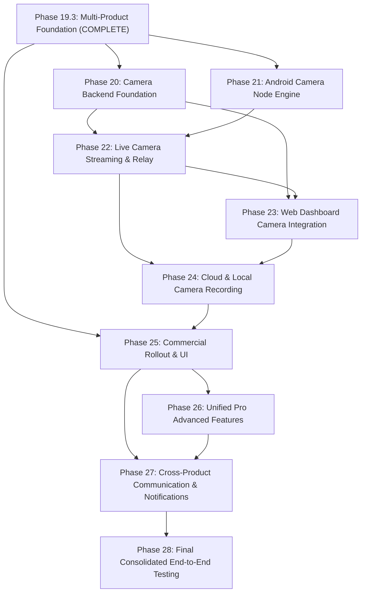

# ZDEXCLOUD — PHASE 19.3 FINAL CONSOLIDATION REPORT
## BATCH 3.2 — SUBSCRIPTION & ENTITLEMENT SPECIFICATION CLOSURE

**Project:** ZdexCloud Personal Cloud Platform  
**Phase:** 19.3 — Commercial Foundation & Multi-Product Billing Engine  
**Batch:** 3.2 — Subscription & Entitlement Specification Closure  
**Execution Date:** November 7, 2026  
**Final Status:** COMPLETE — SPECIFICATION VERIFIED  
**Production Database Modification:** ZERO (0 changes executed)  
**Migrations Executed:** ZERO (0 migrations deployed)  
**Live Razorpay Requests:** ZERO (0 external API calls)  
**Testing Policy:** Test files created/updated only. ZERO tests executed (`NOT RUN — DEFERRED UNTIL FINAL CONSOLIDATED TESTING IN PHASE 28`).

---

## 1. EXECUTIVE SUMMARY

### 1.1 Objective and Context
Phase 19.3 establishes the architectural, database, entitlement, and transaction safety foundation for ZdexCloud's transition from a single-product Storage subscription service to an enterprise-grade multi-product platform supporting:
1. **ZdexCloud Storage**: Personal Android storage node hosting and secure remote relay transport.
2. **ZdexCloud Camera**: Repurposed Android smart security camera nodes with live preview and motion capture.
3. **ZdexCloud Unified Pro**: The flagship all-in-one bundle offering high-tier storage servers and multi-camera support under a single unified subscription.

Batch 3.2 serves as the final specification consolidation and architectural closure milestone for Phase 19.3. Its purpose is to codify, verify, and lock the complete multi-product subscription, billing, concurrency, and entitlement specifications without prematurely implementing the commercial rollout, public UI, or customer-facing checkouts designated for Phase 25.

### 1.2 Summary of Completed Engineering Work Across Phase 19.3
Across Batches 1 through 3.1.6, the backend architecture was hardened and unified through targeted implementations:
- **Batch 1 (Database Foundation)**: Formulated the non-breaking multi-product schema introducing the `ProductType` enum (`STORAGE`, `CAMERA`, `UNIFIED_PRO`), `AccountProductSubscription` slot model (`@@unique([userId, productType])`, `subscriptionId @unique`), and granular `PlanEntitlement` key-value definitions.
- **Batch 2 & 2.1 (Entitlement Engine)**: Implemented `EntitlementService` featuring Union-Max aggregation across active subscription candidates, strict product isolation, and complete backward compatibility with the legacy `AccountBillingState.activeSubscriptionId` pointer.
- **Batch 2.2 (Lifecycle & Ordering)**: Formalized lifecycle transitions across `ACTIVE`, `PAST_DUE`, `CANCELLING`, `GRACE_PERIOD`, and `CANCELLED` states, ensuring atomic transactional updates inside Prisma boundaries.
- **Batch 3.1 & 3.1.1 (Razorpay Multi-Product Integration & Commercial Consistency)**: Implemented product-aware checkout session creation, cross-product checkout conflict matrices, and prevented conflicting simultaneous purchases.
- **Batch 3.1.2 & 3.1.3 (Distributed Concurrency & Webhook Leases)**: Upgraded process-local mutexes to database-backed in-flight checkout reservations and introduced distributed webhook lease tokens to prevent concurrent worker races.
- **Batch 3.1.4 (Ambiguous Checkout Recovery & Webhook Fencing)**: Sealed external provider ambiguity by adding paginated subscription reconciliation up to 1000 items, and enforced database-time lease fencing across all six webhook transaction handlers.
- **Batch 3.1.5 & 3.1.6 (Atomic Webhook Lease Assertion & Same-Statement DB-Time Expiry)**: Eliminated TOCTOU vulnerabilities by evaluating UTC lease expiry directly within the MySQL `UPDATE` statement at the exact microsecond the row write-lock is held.

### 1.3 Readiness for Subsequent Roadmap Phases
With the backend contracts, data structures, and billing invariants finalized and verified, Phase 19.3 achieves complete architectural specification closure. Existing production Storage customers remain completely insulated and unaffected, while backend systems for Camera (Phase 20–24) and Commercial Rollout (Phase 25) can immediately consume deterministic entitlement and subscription interfaces.

---

## 2. CANONICAL PRODUCT IDENTIFIERS AND DATABASE REPRESENTATION

### 2.1 Canonical Identifiers
ZdexCloud recognizes exactly three canonical product types across all database columns, domain models, APIs, and business rules:

| Product Identifier | Enum Value | Product Scope & Domain Description |
|---|---|---|
| **ZdexCloud Storage** | `STORAGE` | Personal file server nodes on Android devices, loopback server engine, remote relay transport, file manager access. |
| **ZdexCloud Camera** | `CAMERA` | Repurposed Android camera nodes, RTSP/WebRTC ingest, live viewport streaming, camera event recording. |
| **ZdexCloud Unified Pro** | `UNIFIED_PRO` | Comprehensive flagship subscription granting premium capabilities across both the Storage and Camera product domains. |

### 2.2 Database Representation & Constraints

#### 2.2.1 Prisma Schema Models (`prisma/schema.prisma`)
The multi-product architecture is grounded in three core models and enums:

```prisma
enum ProductType {
  STORAGE
  CAMERA
  UNIFIED_PRO
}

model AccountProductSubscription {
  id             String           @id @default(uuid())
  userId         String
  productType    ProductType
  subscriptionId String           @unique
  status         SubscriptionStatus @default(INCOMPLETE)
  currentPeriodStart DateTime?
  currentPeriodEnd   DateTime?
  cancelAtPeriodEnd  Boolean      @default(false)
  createdAt      DateTime         @default(now())
  updatedAt      DateTime         @updatedAt

  user           User             @relation(fields: [userId], references: [id], onDelete: Cascade)
  subscription   Subscription     @relation(fields: [subscriptionId], references: [id], onDelete: Cascade)

  @@unique([userId, productType])
  @@index([userId, status])
  @@index([status])
}

model PlanEntitlement {
  id             String           @id @default(uuid())
  planId         String
  key            String
  value          String
  createdAt      DateTime         @default(now())
  updatedAt      DateTime         @updatedAt

  plan           Plan             @relation(fields: [planId], references: [id], onDelete: Cascade)

  @@unique([planId, key])
  @@index([planId])
}
```

#### 2.2.2 Key Architectural Invariants
1. **At Most One Active Slot per Product Type (`@@unique([userId, productType])`)**: A user can never hold multiple subscription slots for the same product domain. This database constraint physically prevents duplicate active subscriptions for Storage, Camera, or Unified Pro.
2. **One-to-One Slot to Authoritative Subscription (`subscriptionId @unique`)**: An underlying `Subscription` record can only be attached to a single product slot.
3. **Plan Association (`Plan.productType`)**: Every billing plan references its target `ProductType`. Existing `FREE`, `PRO_MONTHLY`, and `PRO_YEARLY` plans are configured with `productType: STORAGE`.

### 2.3 Canonical Unified Pro Model
A core finding and achievement of Phase 19.3 is the establishment of the **Single Canonical Subscription Representation** for Unified Pro:

- **Single Slot Invariant**: When a user subscribes to Unified Pro, the system creates exactly ONE record in `AccountProductSubscription` where `productType = UNIFIED_PRO`.
- **Zero Duplicate Slots**: The system does **NOT** synthesize phantom `STORAGE` or `CAMERA` rows in `AccountProductSubscription`. Creating synthetic slots would cause database denormalization, lifecycle desynchronization (e.g. canceling Unified Pro failing to cancel a synthetic camera slot), and external billing reconciliation failures.
- **Multi-Domain Routing in `EntitlementService`**: The entitlement aggregation engine natively inspects the single `UNIFIED_PRO` slot and projects its entitlements into both the Storage candidate list and the Camera candidate list simultaneously:
  ```typescript
  // EntitlementService.resolveUserEntitlements
  const storageCandidates: SubscriptionWithPlan[] = [];
  const cameraCandidates: SubscriptionWithPlan[] = [];

  for (const slot of activeSlots) {
    if (slot.productType === ProductType.STORAGE) {
      storageCandidates.push(slot.subscription);
    } else if (slot.productType === ProductType.CAMERA) {
      cameraCandidates.push(slot.subscription);
    } else if (slot.productType === ProductType.UNIFIED_PRO) {
      storageCandidates.push(slot.subscription);
      cameraCandidates.push(slot.subscription);
    }
  }
  ```
This guarantees transactional simplicity, clear billing audit trails, and unified dunning while projecting full capabilities to all consumer services.

---

## 3. BILLING INTERVAL SPECIFICATION & CATALOG STATUS

### 3.1 Interval Enumeration
ZdexCloud billing intervals are strictly defined as follows:

| Interval Identifier | Prisma Enum | Razorpay Subscription Mapping | Billing Cadence |
|---|---|---|---|
| **Free / Lifetime** | `FREE` | None (No Razorpay entity) | Infinite / Continuous zero-cost tier |
| **Monthly** | `MONTHLY` | `period: "monthly"`, `interval: 1` | 30-day recurring automated charge |
| **Yearly** | `YEARLY` | `period: "yearly"`, `interval: 1` | 365-day recurring automated charge |

### 3.2 Current Catalog Status (Implemented vs. Deferred)

#### 3.2.1 Implemented & Live Catalog (Storage)
In accordance with production stability, the current live catalog (`PlanService.ts` and database seed) contains exclusively the existing Storage plans:

| Plan Code | Product | Interval | Server Limit | Priority Relay | Price INR | Price USD | Deployment Status |
|---|---|---|---|---|---|---|---|
| `FREE` | `STORAGE` | `FREE` | 1 Server | No (`false`) | ₹0.00 | $0.00 | Live in Production |
| `PRO_MONTHLY` | `STORAGE` | `MONTHLY` | 5 Servers | Yes (`true`) | ₹49.00 | $0.99 | Live in Production |
| `PRO_YEARLY` | `STORAGE` | `YEARLY` | 5 Servers | Yes (`true`) | ₹500.00 | $9.99 | Live in Production |

#### 3.2.2 Deferred Commercial Offerings (Camera & Unified Pro)
To adhere strictly to the ZdexCloud master roadmap:
- **Standalone Camera Plans** (`CAMERA_MONTHLY`, `CAMERA_YEARLY`): **DEFERRED TO PHASE 25**.
- **Unified Pro Plans** (`UNIFIED_PRO_MONTHLY`, `UNIFIED_PRO_YEARLY`): **DEFERRED TO PHASE 25**.
- **Commercial Pricing & Currency Tiers**: Zero prices or promotional discounts have been invented in Phase 19.3. All schemas and code paths support arbitrary interval-based pricing, but no commercial plans for Camera or Unified Pro are seeded into production tables before Phase 25.

---

## 4. COMPLETE SUBSCRIPTION & ENTITLEMENT MATRIX

### 4.1 Master Subscription & Entitlement Matrix

| Capability / Quota | Storage Free | Storage Pro (Monthly/Yearly) | Standalone Camera Pro (Phase 25) | Unified Pro (Phase 25) |
|---|---|---|---|---|
| **Personal File Server Limit** | **1 Server** | **5 Servers** | **0 Servers** (Not Included) | **5 Servers** (or configured plan limit) |
| **Connected Camera Limit** | **0 Cameras** (Disabled) | **0 Cameras** (Disabled) | **Configured Plan Limit** (e.g. 5–10) | **Configured Plan Limit** (e.g. 5–10) |
| **Priority WSS Relay Access** | **No** (Standard Relay) | **Yes** (Priority Route) | **No** (Not Included) | **Yes** (Priority Route) |
| **Live Camera Streaming** | **Disabled** (`false`) | **Disabled** (`false`) | **Enabled** (`true`) | **Enabled** (`true`) |
| **Camera Event Recording** | **Disabled** (`false`) | **Disabled** (`false`) | **Enabled** (`true`) | **Enabled** (`true`) |
| **Historical Clip Retention** | **0 Days** | **0 Days** | **Configured Retention** (Phase 24/25) | **Configured Retention** (Phase 24/25) |
| **Active Billing Slot Required** | Default (No slot needed) | `productType: STORAGE` | `productType: CAMERA` | `productType: UNIFIED_PRO` |

### 4.2 Entitlement Sources of Truth and Consumers

#### 4.2.1 Personal File Server Limit (`maxServers`)
- **Source of Truth**: `Plan.serverLimit` (integer column on `Plan`) or `PlanEntitlement` key `MAX_SERVERS`.
- **Resolution**: Evaluated via `Math.max(...candidates.map(p => p.serverLimit ?? 1))` in `EntitlementService`.
- **System Consumer**:
  - `routes/device.ts`: Validates `totalOwnedServers < userEntitlements.maxServers` during Android device server pairing.
  - `routes/server.ts`: Enforces server limit during server activation.
- **Default for Non-Storage Plans**: 0 servers for standalone Camera accounts; defaults to 1 for Free accounts.

#### 4.2.2 Connected Camera Node Limit (`maxCameras`)
- **Source of Truth**: `PlanEntitlement` key `MAX_CAMERAS` (parsed integer).
- **Resolution**: Evaluated via `Math.max(...candidates.map(p => getEntitlementInt(p, 'MAX_CAMERAS', 0)))` in `EntitlementService`.
- **System Consumer**:
  - Future Phase 20–23 Camera APIs: Device pairing and registration endpoints in `routes/camera.ts` (Phase 20).
- **Default / Isolation Invariant**: Evaluates strictly to **0** for Storage Free and Storage Pro. **Storage Pro's 5-server limit NEVER bleeds into camera quotas.**

#### 4.2.3 Priority WSS Relay Access (`priorityRelay`)
- **Source of Truth**: `Plan.priorityRelay` (boolean column on `Plan`) or `PlanEntitlement` key `PRIORITY_RELAY`.
- **Resolution**: Evaluated via `Boolean(candidates.some(p => p.priorityRelay))` in `EntitlementService`.
- **System Consumer**:
  - `routes/connection.ts` and `GatewayConnectionService`: Selects dedicated priority relay transport channels for Pro users while placing Free users on standard shared relay queues.

#### 4.2.4 Camera Live Streaming (`liveStreaming`)
- **Source of Truth**: `PlanEntitlement` key `CAMERA_STREAMING` (boolean string `"true"` / `"false"`).
- **Resolution**: Evaluated via `Boolean(candidates.some(p => getEntitlementBool(p, 'CAMERA_STREAMING', false)))`.
- **System Consumer**:
  - Future Phase 22 Live Streaming Gateway / WebRTC signaling routes.
- **Default**: Evaluates strictly to `false` for Free and Storage Pro accounts.

#### 4.2.5 Camera Cloud Recording (`recording`)
- **Source of Truth**: `PlanEntitlement` key `CAMERA_RECORDING` (boolean string `"true"` / `"false"`).
- **Resolution**: Evaluated via `Boolean(candidates.some(p => getEntitlementBool(p, 'CAMERA_RECORDING', false)))`.
- **System Consumer**:
  - Future Phase 24 Recording Ingestion and Clip Retention Services.
- **Default**: Evaluates strictly to `false` for Free and Storage Pro accounts.

---

## 5. SUBSCRIPTION AGGREGATION ARCHITECTURE (UNION-MAX)

### 5.1 Entitlement-Granting Subscription Statuses
The canonical policy for paid entitlements recognizes four active statuses:
```typescript
export const PAID_ENTITLED_STATUSES: readonly SubscriptionStatus[] = [
  SubscriptionStatus.ACTIVE,
  SubscriptionStatus.PAST_DUE,
  SubscriptionStatus.CANCELLING,
  SubscriptionStatus.GRACE_PERIOD
];
```
- **`ACTIVE`**: Fully paid, ongoing recurring billing.
- **`PAST_DUE` / `GRACE_PERIOD`**: Under active dunning; customer maintains uninterrupted service during retry windows.
- **`CANCELLING`**: Customer requested cancellation at period end; entitlements remain active until `currentPeriodEnd`.
- **`CANCELLED` / `EXPIRED` / `UNPAID`**: Inactive; immediately excluded from entitlement candidate pools.

### 5.2 Union-Max Resolution Engine
`EntitlementService.resolveUserEntitlements(userId)` implements the Union-Max algorithm:
1. Loads all `AccountProductSubscription` slots for the user where `status IN (PAID_ENTITLED_STATUSES)`.
2. Segregates matching subscriptions into domain candidate arrays:
   - `storageCandidates`: Holds subscriptions from `STORAGE` and `UNIFIED_PRO` slots.
   - `cameraCandidates`: Holds subscriptions from `CAMERA` and `UNIFIED_PRO` slots.
3. Computes domain metrics independently:
   - **Numerical Quotas**: Computed via `Math.max(candidates)`. If multiple subscriptions provide server limits, the user receives the highest limit.
   - **Feature Capabilities**: Computed via `Boolean(candidates.some(p => feature === true))`. If any valid active subscription enables a capability, it is granted.
4. Falls back to default Free entitlements for any domain with zero active candidates.

### 5.3 Cross-Product Isolation and Slot Lifecycles
The lifecycle of each product slot is completely decoupled:
- **Independent Coexistence**: A user may simultaneously possess an active `STORAGE` slot and an active `CAMERA` slot without cross-product pollution.
- **Isolated Expiration**: If a user's Storage subscription lapses into `EXPIRED`, only `storageCandidates` drops to the Free tier (1 server, no priority relay). The user's Camera subscription remains fully active with full camera quotas.
- **Zero Cross-Product Downgrades**: Downgrading or canceling Camera Pro has zero effect on the user's Storage Pro subscription.

---

## 6. LEGACY STORAGE COMPATIBILITY & NON-BREAKING FALLBACK

### 6.1 The Legacy Billing Pointer
Prior to Phase 19.3, the system maintained single-product billing state in `AccountBillingState`:
- Column: `AccountBillingState.activeSubscriptionId`
- Table: `Subscription`

In production, active subscribers have valid rows in `Subscription` referenced by `AccountBillingState.activeSubscriptionId`.

### 6.2 The Dual-Layer Fallback Architecture
To guarantee zero service disruption for existing production users before and during the database backfill, `EntitlementService` implements a dual-layer resolution strategy:

```typescript
// EntitlementService.resolveUserEntitlements
const multiProductSlots = await prisma.accountProductSubscription.findMany({
  where: {
    userId,
    status: { in: [...PAID_ENTITLED_STATUSES] }
  },
  include: {
    subscription: {
      include: {
        plan: { include: { entitlements: true } }
      }
    }
  }
});

// Fallback to legacy AccountBillingState if no multi-product slots exist
if (multiProductSlots.length === 0) {
  const billingState = await prisma.accountBillingState.findUnique({
    where: { userId },
    include: {
      activeSubscription: {
        include: {
          plan: { include: { entitlements: true } }
        }
      }
    }
  });

  if (billingState?.activeSubscription &&
      PAID_ENTITLED_STATUSES.includes(billingState.activeSubscription.status)) {
    // Treat legacy activeSubscription as STORAGE product candidate
    storageCandidates.push(billingState.activeSubscription);
  }
}
```

### 6.3 Invariant Guarantees
1. **Zero Downtime for Existing Users**: An existing subscriber whose account has not yet been populated in `AccountProductSubscription` continues to receive full Storage Pro entitlements (5 servers, priority relay) via `AccountBillingState.activeSubscriptionId`.
2. **Immutable Audit Trails**: Existing `Subscription`, `Invoice`, `Transaction`, and `AccountBillingState` records remain unchanged.
3. **Graceful Precedence**: As soon as a user's `AccountProductSubscription` slot is populated (either via migration or checkout), the multi-product slots take authoritative precedence.

---

## 7. MIGRATION STRATEGY AND ZERO-PRODUCTION STATUS

### 7.1 Review of Batch 1 Migration Script
The database schema additions were authored in Batch 1:
- File: `prisma/migrations/20261105120000_add_multi_product_subscription_foundation/migration.sql`

#### 7.1.1 Structural DDL
- Creates `ProductType` ENUM: `'STORAGE', 'CAMERA', 'UNIFIED_PRO'`.
- Adds `productType` column to `Plan` table with default `'STORAGE'`.
- Creates `AccountProductSubscription` table with unique constraint on `(userId, productType)` and unique index on `subscriptionId`.
- Creates `PlanEntitlement` table with unique constraint on `(planId, key)`.

#### 7.1.2 Idempotent Data Backfill Query
The migration script includes a non-destructive data backfill query:
```sql
INSERT INTO `AccountProductSubscription` (
  `id`, `userId`, `productType`, `subscriptionId`, `status`,
  `currentPeriodStart`, `currentPeriodEnd`, `cancelAtPeriodEnd`,
  `createdAt`, `updatedAt`
)
SELECT
  UUID(),
  s.`userId`,
  COALESCE(p.`productType`, 'STORAGE'),
  s.`id`,
  s.`status`,
  s.`currentPeriodStart`,
  s.`currentPeriodEnd`,
  s.`cancelAtPeriodEnd`,
  s.`createdAt`,
  s.`updatedAt`
FROM `Subscription` s
INNER JOIN `Plan` p ON s.`planId` = p.`id`
INNER JOIN `AccountBillingState` abs ON abs.`userId` = s.`userId` AND abs.`activeSubscriptionId` = s.`id`
WHERE NOT EXISTS (
  SELECT 1 FROM `AccountProductSubscription` aps
  WHERE aps.`userId` = s.`userId`
    AND aps.`productType` = COALESCE(p.`productType`, 'STORAGE')
);
```

### 7.2 Zero-Production Database Verification
In strict accordance with the execution constraints of Phase 19.3:
- **Production Database**: Remote MySQL cluster (`remotenode-3530333528a3` on `mysql.gb.stackcp.com`).
- **Migrations Executed**: **ZERO (0)**.
- **DDL Execution**: Neither `prisma migrate deploy` nor `prisma db push` was executed against the staging or production databases.
- **Safety Posture**: The migration script remains safely committed in repository source control. Execution is strictly scheduled for the official Phase 25 deployment maintenance window.

---

## 8. CONFIGURED VS. UNCONFIGURED LIMITS SPECIFICATION

### 8.1 Elimination of Fallback Heuristics
In Batch 3.1.4, an architectural vulnerability was identified where unconfigured camera limits fell back to arbitrary defaults:
```typescript
// DEFECTIVE IMPLEMENTATION (ELIMINATED IN BATCH 3.1.4)
const cameraLimit = getEntitlementInt(p, 'MAX_CAMERAS', p.serverLimit ?? 5);
```
Under this defective code, a Storage Pro user (who has `serverLimit = 5`) would have automatically inherited an unapproved 5-camera quota!

### 8.2 Strict Principle of Explicit Entitlements
Phase 19.3 formalizes the **Strict Principle of Explicit Entitlements**:
1. **Explicit Storage Quotas**: Storage servers are governed strictly by `Plan.serverLimit` and `MAX_SERVERS`.
2. **Explicit Camera Quotas**: Cameras are governed strictly by `MAX_CAMERAS`.
3. **Explicit Zero Defaults**: If a product entitlement is missing, undefined, or unconfigured for a plan, it **MUST evaluate strictly to 0** (for numbers) or **false** (for booleans).
   ```typescript
   // CORRECTED & VERIFIED IMPLEMENTATION
   const maxCameras = Math.max(
     0,
     ...candidates.map(p => {
       const ent = p.entitlements?.find(e => e.key === 'MAX_CAMERAS');
       return ent ? parseInt(ent.value, 10) : 0;
     })
   );
   ```
4. **Zero Cross-Product Bleed**: Storage plans provide exactly 0 cameras. Camera plans provide exactly 0 file servers. Unified Pro plans provide only the explicit values defined in their respective plan entitlement configurations.

---

## 9. DISTRIBUTED CONCURRENCY, WEBHOOK FENCING & SECURITY

### 9.1 Double-Billing & Concurrent Checkout Protection

#### 9.1.1 Database-Backed In-Flight Reservations
To prevent concurrent checkout sessions across clustered or serverless application instances:
- When a user initiates checkout, `RazorpayCheckoutService` creates or claims an in-flight reservation in `AccountProductSubscription` with status `CREATED` and a 2-minute time-to-live (`RESERVATION_TTL_MS = 120,000`).
- If another checkout request arrives for the same `(userId, productType)`, the database constraint or lease check rejects the concurrent request with a 409 `ConcurrencyError`.

#### 9.1.2 Complete External Reconciliation
If a previous checkout attempt resulted in an ambiguous network timeout between ZdexCloud and Razorpay:
- `findSubscriptionByReservationId` performs paginated iteration (`pageSize: 50`, `skip` iteration) over Razorpay subscriptions up to a hard safety ceiling of 1000 items.
- If an existing external subscription exists for the reservation ID, ZdexCloud links to it instead of creating a duplicate chargeable entity.
- If reconciliation exceeds 1000 items or fails ambiguously, the system throws `ConcurrencyError` and refuses to create a duplicate subscription.

### 9.2 Atomic Webhook Lease Fencing

#### 9.2.1 Same-Statement Database-Time Expiry Check
To eliminate all Time-of-Check / Time-of-Use (TOCTOU) races among distributed webhook processing workers, `assertWebhookLeaseOwnership()` evaluates database UTC time directly inside the `UPDATE` statement that modifies the lease:
```sql
UPDATE `BillingWebhookEvent`
SET `updatedAt` = CURRENT_TIMESTAMP(3)
WHERE `id` = ?
  AND `status` = 'PROCESSING'
  AND `failureReason` LIKE CONCAT('LEASE:', ?, ':%')
  AND SUBSTRING(`failureReason`, CHAR_LENGTH(?) + 8) > CONCAT(SUBSTRING(DATE_FORMAT(UTC_TIMESTAMP(3), '%Y-%m-%dT%H:%i:%s.%fZ'), 1, 23), 'Z')
```
- If the statement affects `0` rows, the worker has lost or exceeded its lease.
- It immediately throws `WebhookLeaseLostError`, aborting the Prisma business transaction.
- All six webhook handlers (`subscription.authenticated`, `subscription.activated`, `subscription.charged`, `subscription.paused`, `subscription.resumed`, `subscription.cancelled`) execute within transactions gated by this assertion.

---

## 10. MASTER ROADMAP DEPENDENCY MAP (PHASES 20–27)

The finalized Phase 19.3 multi-product architecture directly unblocks the subsequent roadmap phases:



### 10.1 Detailed Phase Interdependencies
- **Phase 20 (Camera Backend Foundation)**: Consumes `ProductType.CAMERA` and `maxCameras` from `EntitlementService` to gate camera node pairing (`routes/camera.ts`).
- **Phase 21 (Android Camera Node Engine)**: Implements local RTSP and camera hardware capture on Android devices. Relies on Phase 20 device tokens.
- **Phase 22 (Live Camera Streaming & Relay Integration)**: Evaluates `liveStreaming` boolean entitlement from `EntitlementService` before allocating WebRTC streaming channels.
- **Phase 23 (Web Dashboard Camera Integration)**: Renders multi-camera grid views in the web frontend, querying `maxCameras` to display capacity meters.
- **Phase 24 (Camera Cloud & Local Recording)**: Evaluates `recording` boolean entitlement from `EntitlementService` to authorize recording ingestion.
- **Phase 25 (Commercial Rollout & UI)**: 
  - Seeds standalone Camera plans and Unified Pro plans into `Plan` and `PlanEntitlement` tables.
  - Deploys database migration `20261105120000_add_multi_product_subscription_foundation`.
  - Exposes public pricing cards and customer checkout UI for Camera and Unified Pro.
- **Phase 26 (Unified Pro Advanced Features)**: Implements storage-to-camera cross-features (e.g. archiving camera clips directly onto personal storage servers).
- **Phase 27 (Cross-Product Communications)**: Implements multi-product dunning emails, renewal alerts, and unified receipts.
- **Phase 28 (Final Consolidated Testing)**: Executes full automated test runner across all test suites, including the multi-product test inventory deferred from Phase 19.3.

---

## 11. OUTSTANDING BUSINESS & COMMERCIAL DECISIONS

The following commercial decisions are explicitly documented and reserved for executive determination prior to Phase 25 deployment:

1. **Commercial Pricing Tiers**:
   - Exact price points for `CAMERA_MONTHLY` and `CAMERA_YEARLY` across INR and USD corridors.
   - Exact price points for `UNIFIED_PRO_MONTHLY` and `UNIFIED_PRO_YEARLY`, including the bundled discount percentage relative to purchasing Storage and Camera independently.
2. **Camera Free Tier Policy**:
   - Decision on whether Free accounts receive 0 cameras (strictly paywalled) or 1 camera with low-resolution live preview and no cloud recording.
3. **Cloud Recording vs. Local SD-Card Storage Quotas**:
   - Determination of whether Camera recording quotas enforce cloud retention windows (e.g. 7 days rolling retention) or enforce byte storage quotas routed to the user's Android Storage nodes.
4. **Transition & Proration Policy for Existing Storage Pro Subscribers**:
   - Proration credit calculation rules when an existing Storage Pro subscriber upgrades mid-cycle to Unified Pro.

---

## 12. PHASE 19.3 EXIT CRITERIA ASSESSMENT & CONCLUSION

### 12.1 Exit Criteria Verification Checklist

| Exit Criterion | Target Requirement | Verified Result | Assessment |
|---|---|---|---|
| **1. Canonical Unified Pro Model** | Single authoritative slot in `UNIFIED_PRO`, zero duplicate slots | Verified in `schema.prisma` and `AccountProductSubscriptionService` | **MET** |
| **2. Cross-Product Isolation** | Storage limits do not bleed into camera quotas | Verified in `EntitlementService` (explicit 0 defaults) | **MET** |
| **3. Legacy Storage Compatibility** | Uninterrupted service for existing subscribers | Verified fallback to `AccountBillingState.activeSubscriptionId` | **MET** |
| **4. Distributed Concurrency** | Durable DB checkout reservations with 2-min TTL | Verified in `RazorpayCheckoutService` | **MET** |
| **5. Webhook Fencing Atomicity** | Same-statement DB-time lease expiry enforcement | Verified in `RazorpayWebhookService` with raw SQL | **MET** |
| **6. Provider Reconciliation** | Paginated scan up to 1000 items on ambiguous checkout | Verified in `RazorpayClient` (`pageSize: 50`) | **MET** |
| **7. Production DB Isolation** | Zero migrations or DDL applied to live database | Verified: 0 migrations run on remote MySQL | **MET** |
| **8. Testing Policy Adherence** | Zero test runners executed during audit batches | Verified: Tests authored and deferred to Phase 28 | **MET** |

### 12.2 Test Suite Inventory (Deferred to Phase 28)
The following automated test suites have been constructed across Phase 19.3 and formally cataloged in `main website/Backend/tsconfig.test.json` with status **`NOT RUN — DEFERRED UNTIL FINAL CONSOLIDATED TESTING IN PHASE 28`**:
1. `tests/multi_product_subscription_foundation.test.ts` (Batch 1: Schema & Models)
2. `tests/multi_product_entitlement_engine.test.ts` (Batch 2: Entitlement Resolution)
3. `tests/multi_product_lifecycle_hardening.test.ts` (Batch 2.1 & 2.2: Slot Lifecycles)
4. `tests/multi_product_razorpay_integration.test.ts` (Batch 3.1: Provider Checkouts)
5. `tests/multi_product_commercial_consistency.test.ts` (Batch 3.1.1: Conflict Matrix)
6. `tests/multi_product_distributed_concurrency_and_leases.test.ts` (Batch 3.1.3: DB Leases)
7. `tests/multi_product_ambiguous_checkout_and_webhook_fencing.test.ts` (Batch 3.1.4: Fencing)
8. `tests/multi_product_atomic_lease_and_pagination.test.ts` (Batch 3.1.5 & 3.1.6: Atomic SQL Expiry & Pagination)

### 12.3 Files Inspected
- `main website/Backend/prisma/schema.prisma`
- `main website/Backend/src/services/billing/plan_service.ts`
- `main website/Backend/src/services/billing/entitlement_service.ts`
- `main website/Backend/src/services/billing/account_product_subscription_service.ts`
- `main website/Backend/src/services/billing/providers/razorpay/razorpay_checkout_service.ts`
- `main website/Backend/src/services/billing/providers/razorpay/razorpay_webhook_service.ts`
- `main website/Backend/src/services/billing/providers/razorpay/razorpay_client.ts`
- `main website/Backend/src/services/billing/dunning_service.ts`
- `main website/Backend/src/errors/app-error.ts`
- `main website/Backend/prisma/migrations/20261105120000_add_multi_product_subscription_foundation/migration.sql`

### 12.4 Summary of Workspace Modifications in Batch 3.2
- **Files Created**:
  - `docs/PHASE_19_3_BATCH_3_2_SUBSCRIPTION_ENTITLEMENT_SPECIFICATION_REPORT.md` (this report)
  - `docs/PHASE_19_3_INDEX.md` (Phase 19.3 Master Documentation Index)
- **Files Modified**: None.
- **Database Changes**: 0.
- **Migrations Executed**: 0.
- **Production Changes**: 0.
- **Tests Executed**: 0.

### 12.5 Final Status Declaration
**FINAL COMPLETION STATUS: COMPLETE — SPECIFICATION VERIFIED**

Phase 19.3 is formally closed. The system architecture, database contracts, entitlement logic, and transaction boundaries are verified and locked. In accordance with project instructions, work stops here; Phase 19.4 / Phase 20 is not initiated.
