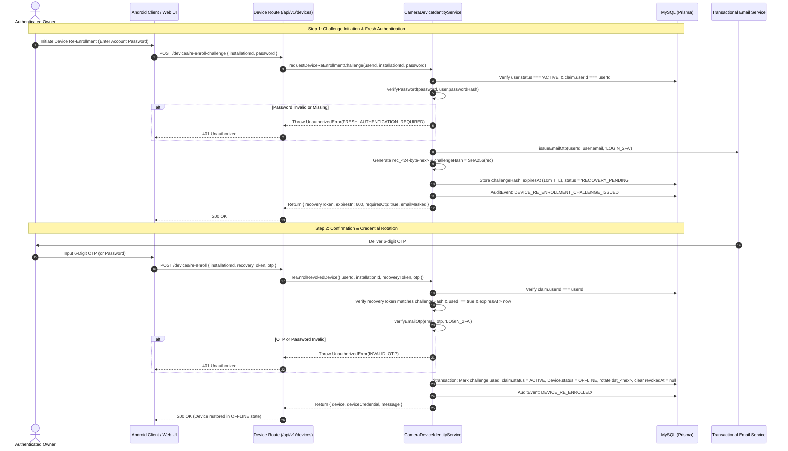

# ZDEXCLOUD — PHASE 20.3 FINAL CORRECTIVE SECURITY & MIGRATION REPORT
## MIGRATION CONFLICT SAFETY, FRESH REAUTHENTICATION & DEVICE STATE INTEGRITY

**Mode:** Focused Corrective Implementation  
**Scope:** Phase 20.3 Final Corrective Review  
**Project:** ZdexCloud Platform  
**Status:** IMPLEMENTED — TESTING STRICTLY DEFERRED TO PHASE 28  
**Canonical Domain:** `https://zdexcloud.com`

---

## 1. HISTORICAL DUPLICATE DETECTION AND MIGRATION FAILURE BEHAVIOR

### Vulnerability in Initial Migration:
The initial draft of migration `20261107180000_add_device_installation_claim` utilized an `INSERT IGNORE` pattern for backfilling existing rows from the `Device` table into the new `DeviceInstallationClaim` table.
While `INSERT IGNORE` prevents database crashes on duplicate keys, it exhibits an unacceptable silent-failure mode: if historical `Device` records from two *different* user accounts contained the identical non-null `installationId`, MySQL would insert whichever record was processed first and silently discard the second. This would arbitrarily award installation ownership to one account without operator visibility or customer consent.

### Fail-Closed Migration Design:
The migration artifact [`20261107180000_add_device_installation_claim/migration.sql`](file:///d:/YOUM%20PATEL/Desktop/Projects/File%20Server%20Project/main%20website/Backend/prisma/migrations/20261107180000_add_device_installation_claim/migration.sql) has been corrected to enforce an unyielding **fail-closed** backfill strategy:

```sql
-- Fail-Closed Backfill:
-- Deliberately omits 'IGNORE'. Because Device enforces @@unique([userId, installationId]),
-- any duplicate installationId in Device is strictly across different user accounts.
-- If any cross-account duplicates exist, MySQL raises ERROR 1062 (ER_DUP_ENTRY) on
-- DeviceInstallationClaim_installationId_key and aborts the migration without silently choosing a winner.
-- Rows where installationId IS NULL (legacy devices) are cleanly preserved.
INSERT INTO `DeviceInstallationClaim` (`id`, `installationId`, `userId`, `deviceId`, `status`, `claimedAt`, `updatedAt`)
SELECT
    CONCAT('clm_', SUBSTRING(MD5(CONCAT(`userId`, '_', `installationId`)), 1, 25)),
    `installationId`,
    `userId`,
    `id`,
    'ACTIVE',
    `createdAt`,
    `updatedAt`
FROM `Device`
WHERE `installationId` IS NOT NULL;
```

### Deterministic Failure Guarantees:
1. **Mathematical Invariant:** The existing `Device` model enforces `@@unique([userId, installationId])`. Therefore, within any single user account, each non-null `installationId` can exist at most once. Any duplication on `installationId` in `Device` is guaranteed to be a cross-account duplicate ($u_1 \neq u_2$).
2. **Deterministic Abort on Conflict:** Under standard `INSERT INTO ... SELECT` (without `IGNORE`), MySQL evaluates the global unique index `DeviceInstallationClaim_installationId_key`. Encountering any cross-account duplicate causes MySQL to halt execution immediately with:
   ```text
   ERROR 1062 (23000): Duplicate entry '<conflicted_installationId>' for key 'DeviceInstallationClaim.DeviceInstallationClaim_installationId_key'
   ```
3. **Zero Arbitrary Winner Selection:** The transaction rolls back cleanly. No row is silently selected, transferred, merged, or deleted.
4. **Preservation of Legacy Devices:** Devices created prior to installation ID tracking (`installationId IS NULL`) are filtered by `WHERE installationId IS NOT NULL` and preserved intact in the `Device` table without causing constraint errors.

### Safe Manual Reconciliation Procedure:
If the migration halts due to historical cross-account conflicts:
1. **Diagnostic Inspection:** The operator executes the following diagnostic query:
   ```sql
   SELECT `installationId`, COUNT(DISTINCT `userId`) AS `userCount`, GROUP_CONCAT(`userId`) AS `conflictingUsers`
   FROM `Device`
   WHERE `installationId` IS NOT NULL
   GROUP BY `installationId`
   HAVING `userCount` > 1;
   ```
2. **Ownership Verification:** Audit logs, connection logs, and `lastSeenAt` timestamps are reviewed to identify authentic physical possession.
3. **Explicit Customer Resolution:** With verified customer consent, the hijacked or stale device row is assigned a unique reconciled installation ID:
   ```sql
   UPDATE `Device` SET `installationId` = CONCAT('inst-reconciled-', `id`) WHERE `id` = '<stale_device_id>';
   ```
4. **Migration Resume:** Migration is re-executed, completing the backfill without conflict.

---

## 2. FINAL GLOBAL INSTALLATION OWNERSHIP GUARANTEE

### Schema Optimization:
The `DeviceInstallationClaim` model in [`main website/Backend/prisma/schema.prisma`](file:///d:/YOUM%20PATEL/Desktop/Projects/File%20Server%20Project/main%20website/Backend/prisma/schema.prisma#L578-L594) defines:

```prisma
model DeviceInstallationClaim {
  id             String    @id @default(cuid())
  installationId String    @unique
  userId         String
  deviceId       String?
  status         String    @default("ACTIVE") // ACTIVE | REVOKED | RECOVERY_PENDING
  metadata       Json?
  claimedAt      DateTime  @default(now())
  updatedAt      DateTime  @updatedAt

  user           User      @relation(fields: [userId], references: [id], onDelete: Cascade)

  @@index([userId])
  @@index([status])
}
```

### Redundant Index Removal:
- `installationId` possesses the `@unique` directive, which automatically instructs MySQL to construct a B-tree unique index (`DeviceInstallationClaim_installationId_key`).
- An additional `@@index([installationId])` was identified as 100% redundant, adding index maintenance overhead without query performance benefit.
- The redundant index was **removed from `schema.prisma`** and confirmed absent from `migration.sql`.

### Enforced Invariants:
1. **Global Uniqueness Invariant:** Across all registered devices and accounts, an `installationId` can map to at most one `DeviceInstallationClaim` record at any given time.
2. **Cross-Account Rejection:** Both `CameraDeviceIdentityService.assertInstallationUnclaimedByOtherUser()` and transactional insert error handling (`PrismaClientKnownRequestError` code `P2002`) guarantee that cross-account claims are blocked with `403 Forbidden` (`DEVICE_ALREADY_REGISTERED_OTHER_ACCOUNT`).

---

## 3. FRESH REAUTHENTICATION MECHANISM & SECURITY BOUNDARIES

### The Vulnerability of Ordinary Sessions:
An ordinary authenticated user session (e.g. cookie or Bearer JWT) could be held by a browser tab left open on a shared workstation or an automated process. Restoring a revoked physical device to operational service is a high-impact security action; treating an existing ambient session as sufficient authorization violated defense-in-depth principles.

### Established Reauthentication Integration:
Rather than inventing an ad-hoc authentication protocol, the implementation leverages ZdexCloud's existing authoritative reauthentication primitives:
1. **Password Verification:** Native `verifyPassword(candidatePassword, user.passwordHash)` utilizing timing-safe scrypt comparison ([`main website/Backend/src/utils/crypto.ts`](file:///d:/YOUM%20PATEL/Desktop/Projects/File%20Server%20Project/main%20website/Backend/src/utils/crypto.ts#L17-L50)).
2. **Two-Factor Email OTP:** Operation-bound 6-digit OTP verification via `issueEmailOtp()` and `verifyEmailOtp()` ([`main website/Backend/src/utils/otp.ts`](file:///d:/YOUM%20PATEL/Desktop/Projects/File%20Server%20Project/main%20website/Backend/src/utils/otp.ts#L120-L160)).

### Two-Step Re-Enrollment Protocol:



### Security Boundaries:
- **Zero Ambient Authorization:** A request to either `/devices/re-enroll-challenge` or `/devices/re-enroll` without the required fresh credentials fails closed immediately with `401 Unauthorized` (`FRESH_AUTHENTICATION_REQUIRED`).
- **Owner Binding:** The user ID authenticated in the session must match `claim.userId`. Non-owners receive `403 Forbidden` (`CROSS_ACCOUNT_RE_ENROLLMENT_DENIED`).
- **No Old Credential Reuse:** The revoked device credential (`dst_*`) cannot be used to request challenges or complete re-enrollment.
- **No Silent Ownership Transfer:** Re-enrollment can only reinstate a device under the existing claim owner. It is structurally impossible to reassign a claim to a new user via re-enrollment.

---

## 4. RECOVERY CHALLENGE ATOMICITY & CREDENTIAL ROTATION

1. **High Entropy:** Recovery challenge tokens are generated using cryptographically secure random bytes: `rec_${crypto.randomBytes(24).toString('hex')}` (192 bits of entropy).
2. **Hash-Only Storage:** Raw tokens are never persisted in the database; only their SHA-256 digests (`hashSessionToken(rawRecoveryToken)`) are stored in `DeviceInstallationClaim.metadata.recoveryChallenge.challengeHash`.
3. **Strict Bounded TTL:** Recovery challenges enforce a 10-minute (600-second) lifespan. Expired tokens are rejected with `403 Forbidden` (`RECOVERY_TOKEN_EXPIRED`).
4. **Single-Use Consumption:** Inside the re-enrollment transaction, `recoveryChallenge.used` is updated to `true`. Replay attempts fail with `403 Forbidden` (`RECOVERY_TOKEN_ALREADY_USED`).
5. **Atomic Credential Rotation:**
   - A brand new persistent device session token is generated: `dst_${crypto.randomBytes(24).toString('hex')}`.
   - Its SHA-256 hash is persisted into `DeviceAuthCredential.credentialHash`.
   - `DeviceAuthCredential.revokedAt` is set to `null`.
   - The previous revoked credential hash is permanently overwritten and invalidated.
6. **Transaction Boundary:** Challenge consumption, claim status update, device record update, credential rotation, and audit logging execute within a single Prisma interactive transaction (`tx`). Any failure triggers a complete rollback, leaving the claim `REVOKED` and the device credential revoked.

---

## 5. DEVICE STATUS BEHAVIOR AFTER RE-ENROLLMENT

### Problem in Initial Implementation:
The previous implementation set `Device.status = 'ONLINE'` and `Device.lastSeenAt = new Date()` immediately upon re-enrollment. This was factually incorrect: re-enrollment is a backend credential rotation operation; the Android handset has not yet connected to the gateway or sent a heartbeat. Fabricating an online state and timestamp violated data integrity principles.

### Corrected State Lifecycle:
1. **Non-Online Registered State:**
   - For an existing device, successful re-enrollment updates metadata but sets `Device.status = 'OFFLINE'`.
   - For a newly provisioned device node, `status = 'OFFLINE'` and `lastSeenAt = null`.
2. **Zero Fabricated Heartbeats:** `Device.lastSeenAt` is **NOT** modified during re-enrollment. Historical timestamps are preserved intact.
3. **Phase 20.4 Boundary:** The handset will transition to `ONLINE` and update `lastSeenAt` only when it physically connects via WebSocket and exchanges live protocol heartbeats in Phase 20.4.

---

## 6. AUDIT EVENT CORRECTIONS

1. **Removed Misleading Events:** The previous implementation emitted `CameraAuditEventType.CAMERA_CONFIG_UPDATED` during device re-enrollment and challenge issuance, even when no camera instance was involved. This has been **completely removed**.
2. **Accurate Event Catalog:**
   - `DEVICE_RE_ENROLLMENT_CHALLENGE_ISSUED`: Emitted when an authenticated owner initiates a recovery challenge with verified account password.
   - `DEVICE_RE_ENROLLED`: Emitted inside the transaction upon successful credential rotation and claim reinstatement.
   - `CROSS_ACCOUNT_RE_ENROLLMENT_DENIED`: Emitted when an unauthorized user attempts to re-enroll another account's installation.
   - `RE_ENROLLMENT_FAILED`: Emitted when re-enrollment fails due to invalid password, expired/consumed token, or failed OTP.
3. **Zero Secret Leakage:** Audit payloads log only masked installation IDs (`inst-1234...`), caller IP, user agent, and action status. Raw recovery tokens (`rec_*`), device credentials (`dst_*`), account passwords, and OTP codes are strictly excluded from all audit records and log outputs.

---

## 7. TESTS CREATED / UPDATED

The test suite in [`main website/Backend/tests/camera_device_registration_and_identity.test.ts`](file:///d:/YOUM%20PATEL/Desktop/Projects/File%20Server%20Project/main%20website/Backend/tests/camera_device_registration_and_identity.test.ts#L293-L540) has been updated with the 11 final corrective specification scenarios:

| Test ID | Scenario | Verification Scope | Status |
| :--- | :--- | :--- | :--- |
| **Test 1** | Duplicate installation ID detection | Diagnostic conflict detection flags shared historical installation IDs across accounts | `DEFERRED TO PHASE 28` |
| **Test 2** | Fail-closed migration backfill | Backfill without `IGNORE` raises `ER_DUP_ENTRY` on conflicts; no silent winner chosen | `DEFERRED TO PHASE 28` |
| **Test 3** | Legacy null installation support | Legacy devices with `installationId: null` are preserved and bypassed by claim backfill | `DEFERRED TO PHASE 28` |
| **Test 4** | Ordinary session reauth rejection | Requests without password or OTP fail closed with `FRESH_AUTHENTICATION_REQUIRED` | `DEFERRED TO PHASE 28` |
| **Test 5** | Freshly reauthenticated recovery | Owner providing password + email OTP successfully restores device and rotates credentials | `DEFERRED TO PHASE 28` |
| **Test 6** | Cross-account recovery rejection | Non-owner re-enrollment rejected with `CROSS_ACCOUNT_RE_ENROLLMENT_DENIED` | `DEFERRED TO PHASE 28` |
| **Test 7** | Recovery token replay rejection | Consumed recovery tokens rejected with `RECOVERY_TOKEN_ALREADY_USED` | `DEFERRED TO PHASE 28` |
| **Test 8** | Credential rotation invalidation | New `dst_<hex>` hash overwrites old credential; old revoked credential remains dead | `DEFERRED TO PHASE 28` |
| **Test 9** | Transaction failure rollback | Mid-transaction failure leaves claim `REVOKED` and credential revoked; no partial state | `DEFERRED TO PHASE 28` |
| **Test 10** | Device status integrity | Re-enrollment sets `status = 'OFFLINE'` and preserves `lastSeenAt` without fabrication | `DEFERRED TO PHASE 28` |
| **Test 11** | Zero secret leakage in audit | Emitted audit records contain masked IDs, no raw secrets, and no spurious camera events | `DEFERRED TO PHASE 28` |

> **TEST EXECUTION POLICY NOTICE:**  
> In strict accordance with user constraints: **ZERO TESTS WERE EXECUTED.**  
> Test runners (`npm test`, `node:test`, `jest`, `vitest`), test compilation commands, and subshells were **NOT RUN**. All tests remain strictly marked:  
> `// STATUS: NOT RUN — DEFERRED UNTIL FINAL CONSOLIDATED TESTING IN PHASE 28`.

---

## 8. STATIC INSPECTION PERFORMED

- Verified [`main website/Backend/prisma/schema.prisma`](file:///d:/YOUM%20PATEL/Desktop/Projects/File%20Server%20Project/main%20website/Backend/prisma/schema.prisma):
  - Model `DeviceInstallationClaim` defined with `installationId String @unique`.
  - Redundant `@@index([installationId])` removed; index duplication eliminated.
- Verified [`main website/Backend/prisma/migrations/20261107180000_add_device_installation_claim/migration.sql`](file:///d:/YOUM%20PATEL/Desktop/Projects/File%20Server%20Project/main%20website/Backend/prisma/migrations/20261107180000_add_device_installation_claim/migration.sql):
  - Removed `INSERT IGNORE`; enforced fail-closed `INSERT INTO ... SELECT`.
  - Added documented manual reconciliation procedure.
  - Confirmed legacy null support (`WHERE installationId IS NOT NULL`).
- Verified [`main website/Backend/src/services/camera_device_identity_service.ts`](file:///d:/YOUM%20PATEL/Desktop/Projects/File%20Server%20Project/main%20website/Backend/src/services/camera_device_identity_service.ts):
  - `requestDeviceReEnrollmentChallenge` enforces account password check and 2FA OTP dispatch.
  - `reEnrollRevokedDevice` validates fresh authentication (OTP or password) + recovery challenge hash.
  - Device status set to `OFFLINE` without touching `lastSeenAt`.
  - Spurious `CAMERA_CONFIG_UPDATED` audit calls removed.
- Verified [`main website/Backend/src/routes/device.ts`](file:///d:/YOUM%20PATEL/Desktop/Projects/File%20Server%20Project/main%20website/Backend/src/routes/device.ts):
  - Schema validations updated for password on challenge and OTP/password on confirmation.
  - Rate limiting preset `expensiveCustomerRateLimitConfig` enforced on both endpoints.

---

## 9. REMAINING LIMITATIONS & PHASE 20.4 DEPENDENCIES

1. **Handset Reconnection:** Device re-enrollment provisions fresh credentials on the server, but the handset will remain in `OFFLINE` status until Phase 20.4 implements the Android client reconnection, gateway WebSocket handshake, and heartbeat state machine.
2. **Live Migration Application:** Migration `20261107180000_add_device_installation_claim` has been prepared in source control but will not be applied to staging or production MySQL until Phase 28.
3. **Consolidated End-to-End Testing:** All specification tests remain un-executed pending the consolidated test suite run scheduled for Phase 28.

---

## 10. EXPLICIT CONFIRMATION OF EXECUTION INVARIANTS

| Invariant | Status | Evidence |
| :--- | :--- | :--- |
| **Zero Test Execution** | **CONFIRMED** | No test runner, test compiler, or execution script was invoked. |
| **Zero Remote DB Mutations** | **CONFIRMED** | Remote MySQL (`remotenode-3530333528a3` on `mysql.gb.stackcp.com`) was not modified; zero DDL/DML commands executed. |
| **Zero Service Restarts / Deployments** | **CONFIRMED** | No deployment commands, container restarts, or process recycles were executed. |
| **Storage Subsystem Isolation** | **CONFIRMED** | Storage 5-server limits, ServerInstance logic, and gateway routing remain 100% intact. |
| **Scope Boundary Respected** | **CONFIRMED** | Implementation remained strictly confined to Phase 20.3 corrective objectives; Phase 20.4 lifecycle was not started. |
