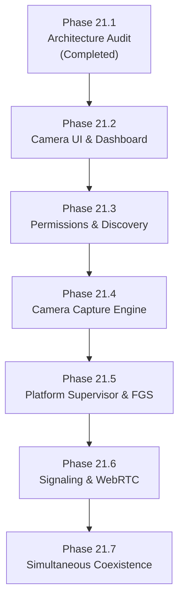

# ZDEXCLOUD — PHASE 21.1 AUDIT REPORT
## Android Camera Architecture Audit & Coexistence Strategy

**Roadmap:** Phase 21 — Android Camera Server  
**Batch:** 21.1 — Android Camera Architecture Audit  
**Execution Mode:** Audit Only — No Implementation  
**Next Batch:** Phase 21.2 — Camera Mode User Interface  
**Testing Policy:** Zero tests executed (`NOT RUN — DEFERRED UNTIL FINAL CONSOLIDATED TESTING IN PHASE 28`).  
**Database Policy:** Zero database mutations, zero schema changes, zero migrations executed.  
**Preservation Invariant:** One Android application; zero regressions to existing Storage (File Server) functionality.

---

## 1. Executive Summary

Phase 21.1 conducts a comprehensive technical audit of the existing ZdexCloud Android application to determine how **Camera Mode** can be seamlessly integrated alongside the existing **Storage Server Mode** within **one single Android application**.

### 1.1 Core Architecture Findings
1. **Single Application Invariant**: The repository contains a single Flutter-based Android application located at `Android app/Android app code`. Both Storage Server and Camera Server functionalities can and must reside inside this single APK. Creating a second application is unnecessary, architecturally redundant, and rejected.
2. **Current Storage Implementation**:
   - **Flutter Layer**: Provides state management (`flutter_riverpod`), UI routing (`AppRouter`), authenticated shell navigation (`AppShell`), and persistent configuration.
   - **Native Kotlin Layer**: Hosts an embedded HTTP file server (`LocalServerEngine`), a WebSocket remote access tunnel (`RemoteNodeTunnelManager`), network monitoring (`NetworkWatcher`), Keystore-backed encrypted storage (`AndroidSecureStorage`), and a persistent Android Foreground Service (`RemoteNodeServerService`).
3. **The Lifecycle Coupling Bottleneck**:
   - In the current implementation, `RemoteNodeServerService` conflates the Android `ForegroundService` lifecycle with the HTTP file server lifecycle. When the user stops the file server, the service calls `stopSelf()`, which tears down the Android service process.
   - **Architectural Imperative**: To support independent operation of Storage Mode, Camera Mode, or **both simultaneously**, the service architecture must be refactored into a **Supervisor Pattern** (`PlatformSupervisorService`), orchestrating two decoupled engines: `StorageEngine` and `CameraEngine`.
4. **Android 14+ (API 34) Foreground Service Constraints**:
   - Current service declares `foregroundServiceType="dataSync|specialUse"`.
   - Accessing the camera hardware from a background/foreground service on Android 14+ strictly mandates declaring `foregroundServiceType="camera"` (and `android.permission.FOREGROUND_SERVICE_CAMERA`) and holding the runtime `android.permission.CAMERA` before service promotion.
   - The unified supervisor service must dynamically combine foreground service types (`dataSync|specialUse|camera`) when both engines run concurrently.

---

## 2. Files and Modules Inspected

The following source files, configuration manifests, and backend interfaces were audited:

### 2.1 Android Native (Kotlin) & Build Configuration
- `Android app/Android app code/android/app/src/main/AndroidManifest.xml` (Permissions, service declarations, boot receiver)
- `Android app/Android app code/android/app/build.gradle.kts` (SDK versions, Java 17 compatibility, dependencies)
- `Android app/Android app code/android/settings.gradle.kts` (Gradle plugins, AGP 9.0.1, Kotlin 2.3.20)
- `Android app/Android app code/android/app/src/main/kotlin/net/remotenode/fileserver/MainActivity.kt` (Platform channels, notifications, folder picker)
- `Android app/Android app code/android/app/src/main/kotlin/net/remotenode/fileserver/RemoteNodeServerService.kt` (Foreground service lifecycle, wake locks, keepalive alarms)
- `Android app/Android app code/android/app/src/main/kotlin/net/remotenode/fileserver/LocalServerEngine.kt` (Embedded HTTP storage engine)
- `Android app/Android app code/android/app/src/main/kotlin/net/remotenode/fileserver/RemoteNodeTunnelManager.kt` (Storage WebSocket gateway client)
- `Android app/Android app code/android/app/src/main/kotlin/net/remotenode/fileserver/NetworkWatcher.kt` (Network connectivity listener)
- `Android app/Android app code/android/app/src/main/kotlin/net/remotenode/fileserver/BatteryOptimizationHelper.kt` (Doze mode exemption intents)
- `Android app/Android app code/android/app/src/main/kotlin/net/remotenode/fileserver/BootReceiver.kt` (Device reboot auto-start)
- `Android app/Android app code/android/app/src/main/kotlin/net/remotenode/fileserver/security/AndroidSecureStorage.kt` (AES-256-GCM Keystore)

### 2.2 Flutter Application (Dart)
- `Android app/Android app code/pubspec.yaml` (Dependencies, assets, Flutter SDK constraints)
- `Android app/Android app code/lib/main.dart` (App root, lifecycle observer, notification handler)
- `Android app/Android app code/lib/core/routing/app_router.dart` (Route declarations and transitions)
- `Android app/Android app code/lib/features/shell/presentation/app_shell.dart` (Bottom navigation shell)
- `Android app/Android app code/lib/features/home/presentation/home_screen.dart` (Control Center dashboard)
- `Android app/Android app code/lib/features/server/domain/services/server_service.dart` (MethodChannel service interface)
- `Android app/Android app code/lib/features/server/presentation/server_status_screen.dart` (Storage server status & controls)
- `Android app/Android app code/lib/features/setup/application/setup_state.dart` (Setup & server state notifier)
- `Android app/Android app code/lib/features/device/domain/services/device_identity_service.dart` (Installation ID resolution)
- `Android app/Android app code/lib/features/remote/domain/services/remote_connection_service.dart` (Remote connection management)
- `Android app/Android app code/lib/features/auth/application/auth_state.dart` (Authentication session management)
- `Android app/Android app code/lib/features/settings/presentation/settings_screen.dart` (Settings and account preferences)

### 2.3 Backend Camera Control Plane & Signaling Foundation
- `main website/Backend/src/routes/camera.ts` (Camera registration, lifecycle, heartbeat, viewing token APIs)
- `main website/Backend/src/services/camera_service.ts` (Camera domain logic and persistence)
- `main website/Backend/src/services/camera_lifecycle_service.ts` (Authoritative lifecycle state transitions)
- `main website/Backend/src/services/camera_signaling_service.ts` (WebRTC signaling, session negotiation, ICE exchange)

---

## 3. Existing Flutter Architecture

### 3.1 Application Entry Point & Navigation
- **Entry (`lib/main.dart`)**: Initializes `WidgetsFlutterBinding`, configures `AppConfig`, initializes `PushNotificationService`, and wraps the application in Riverpod `ProviderScope`.
- **Navigation (`lib/core/routing/app_router.dart`)**:
  - Uses standard declarative routing via `MaterialPageRoute` and named routes.
  - Auth routes: `/login`, `/auth/otp`.
  - Authenticated Shell: `/home` (index 0), `/server` (index 1), `/settings` (index 2).
  - Setup Flow: `/server/setup/device` through `/server/setup/success`.
- **Shell (`lib/features/shell/presentation/app_shell.dart`)**:
  - An `IndexedStack` hosting 3 main tabs: **Home** (`HomeScreen`), **Server** (`ServerScreen`), and **Settings** (`SettingsScreen`).
  - Mobile bottom navigation bar with icons and text labels.

### 3.2 State Management & Riverpod Providers
- State management strictly adheres to `flutter_riverpod: ^2.5.1`.
- Key state holders:
  - `authStateProvider` (`AuthStateNotifier`): Manages customer session, JWT tokens, and 24-hour expiration.
  - `setupStateProvider` (`SetupStateNotifier`): Authoritative frontend state for device registration, server status (`DeviceServerStatus`), subdomain assignment, storage quota, and connection status.
  - `serverServiceProvider` (`MethodChannelServerService`): Interface between Flutter UI and native Kotlin storage engine.

### 3.3 Platform Channel Layer in Flutter
The Flutter layer currently talks to native Android through four channels:
1. `net.remotenode.fileserver/server_engine` (`MethodChannel`): Primary control channel for server start/stop, status checks, device identity, storage discovery, and power readiness.
2. `net.remotenode.fileserver/secure_storage` (`MethodChannel`): Key-value storage backed by Android KeyStore.
3. `net.remotenode.fileserver/network_events` (`EventChannel`): Streams live network transport changes (`WIFI`, `CELLULAR`, `NONE`) and validation states.
4. `net.remotenode.fileserver/tunnel_events` (`EventChannel`): Streams WebSocket connection states (`CONNECTING`, `CONNECTED`, `RECONNECTING`, `ERROR`).

---

## 4. Existing Kotlin Architecture

### 4.1 Platform Channel Dispatching (`MainActivity.kt`)
`MainActivity` extends `FlutterActivity` and registers channel handlers in `configureFlutterEngine`:
- **Server Engine Handler**: Exposes 30+ method endpoints, including `startServer`, `stopServer`, `restartServer`, `startTunnel`, `stopTunnel`, `getInstallationId`, `getStorageReadiness`, `getPowerReadiness`, `isNotificationPermissionGranted`, and `isBatteryOptimizationIgnored`.
- **Clean Disconnect On Destroy**: In `cleanUpFlutterEngine`, the Activity removes tunnel and network listeners without stopping the foreground service (`action=detach_only persistentServerPreserved=true`).

### 4.2 Storage Engine (`LocalServerEngine.kt`)
- Implements a pure Java/Kotlin embedded HTTP server using raw `ServerSocket` and thread pools, replacing non-Android `com.sun.net.httpserver`.
- Serves storage operations: directory browsing (`/api/v1/browse`), chunked file streaming (`/api/v1/download`), resume/range headers, multipart upload processing, and basic HTTP authentication.

### 4.3 Remote Gateway Tunnel (`RemoteNodeTunnelManager.kt`)
- Manages a persistent outbound WebSocket connection to the storage gateway (`wss://gateway.zdexcloud.com`).
- Handles multiplexed HTTP request forwarding from remote browser sessions directly into the local `LocalServerEngine` on `127.0.0.1:8080`.
- Automatically reconnects using infinite bounded exponential backoff and non-interactive device credential renewal.

### 4.4 Hardware-Backed Secure Storage (`AndroidSecureStorage.kt`)
- Manages an AES-256 master key in `AndroidKeyStore`.
- Encrypts session payloads, device credentials, and pairing secrets using AES-256-GCM with 128-bit authentication tags and 12-byte random IVs.

---

## 5. Existing Foreground Service Lifecycle

### 5.1 Service Model (`RemoteNodeServerService.kt`)
- Runs as an Android `Service` promoted to the foreground via `startForeground()`.
- Uses `START_STICKY` in `onStartCommand` to request OS restart if killed under memory pressure.
- Restores active state after device reboot via `BootReceiver` (listening for `BOOT_COMPLETED`, `QUICKBOOT_POWERON`, and `MY_PACKAGE_REPLACED`).

### 5.2 Foreground Notification Ownership
- Single persistent notification (ID `9001`) on low-importance channel `remotenode_server_channel`.
- Content text dynamically reflects storage tunnel states (e.g., "Personal file server on port 8080 | Gateway: Connected").
- Contains two actions: "Open App" and "Stop Server".

### 5.3 Background Execution & Doze Protection
- **WakeLock**: Holds `PowerManager.PARTIAL_WAKE_LOCK` ("net.remotenode:server_wakelock") renewed for 24-hour intervals to prevent CPU sleep.
- **WifiLock**: Holds `WifiManager.WIFI_MODE_FULL_HIGH_PERF` to prevent the Wi-Fi radio from entering power-saving mode during active server hosting.
- **AlarmManager Keepalive**: Schedules exact alarms every 25 seconds (`setExactAndAllowWhileIdle`) targeting `ACTION_KEEPALIVE_PULSE` to keep the gateway tunnel connection active while the device is in Android Doze mode.
- **System Event Receiver**: Dynamically triggers connection recovery on `ACTION_SCREEN_ON`, `ACTION_SCREEN_OFF`, `ACTION_USER_PRESENT`, and `ACTION_POWER_CONNECTED`.

---

## 6. Android SDK and Permission Baseline

### 6.1 SDK Versions & Build Configuration
- `compileOptions`: Java 17 compatibility.
- `kotlin.compilerOptions`: JVM Target 17.
- Minimum SDK: Flutter default `minSdkVersion` (API 21 / Android 5.0).
- Target SDK: Flutter default `targetSdkVersion` (API 34 / Android 14).
- Compile SDK: Flutter default `compileSdkVersion` (API 34/35).

### 6.2 Permission Audit
| Category | Declared in Manifest | Status for Camera Mode |
| :--- | :--- | :--- |
| `android.permission.INTERNET` | **YES** | Reusable for WebRTC and Camera signaling |
| `android.permission.ACCESS_NETWORK_STATE` | **YES** | Reusable |
| `android.permission.FOREGROUND_SERVICE` | **YES** | Reusable |
| `android.permission.FOREGROUND_SERVICE_DATA_SYNC` | **YES** | Used by Storage engine |
| `android.permission.FOREGROUND_SERVICE_SPECIAL_USE` | **YES** | Used by Storage engine |
| `android.permission.FOREGROUND_SERVICE_CAMERA` | **NO** | **MANDATORY for Android 14+ background camera** |
| `android.permission.FOREGROUND_SERVICE_MICROPHONE` | **NO** | **MANDATORY for Android 14+ background audio** |
| `android.permission.CAMERA` | **NO** | **MANDATORY (Runtime dangerous permission)** |
| `android.permission.RECORD_AUDIO` | **NO** | **MANDATORY (Runtime dangerous permission, if audio enabled)** |
| `android.permission.WAKE_LOCK` | **YES** | Reusable for CPU keepalive during streaming |
| `android.permission.POST_NOTIFICATIONS` | **YES** | Reusable for foreground notifications |
| `android.permission.REQUEST_IGNORE_BATTERY_OPTIMIZATIONS` | **YES** | Reusable for continuous streaming |

---

## 7. Camera Hardware Compatibility Findings

### 7.1 Camera Architecture Evaluation (CameraX vs Camera2 vs WebRTC)
Three implementation patterns were evaluated for Android Camera capture:

1. **Option A: Pure CameraX (`androidx.camera`)**:
   - Pros: Lifecycle management, device quirk workarounds, simple resolution binding.
   - Cons: Output frames must be manually copied and converted (YUV_420_888 to I420/NV21) before feeding into a WebRTC video track. This introduces severe CPU overhead, frame dropping, and memory thrashing.
2. **Option B: Native WebRTC Camera2 Integration (`Camera2Capturer`)**:
   - Pros: WebRTC's standard Android SDK provides `org.webrtc.Camera2Capturer` and `org.webrtc.Camera2Enumerator`. It directly binds Android's `CameraDevice` to hardware video encoders (`MediaCodecVideoEncoder` / `DefaultVideoEncoderFactory`) via OpenGL texture surfaces. Zero CPU memory copying; hardware H.264/VP8 encoding directly on the GPU/VPU.
   - Cons: Requires integrating the native WebRTC Android AAR dependency.
3. **Recommendation**: Adopt **WebRTC Native Camera2 Integration** (`Camera2Capturer`). It delivers the highest performance, lowest latency, and minimal CPU/battery footprint, perfectly matching the WebSockets/WebRTC signaling foundation implemented in Phase 20.5.

### 7.2 Hardware Level & Feature Support
- **Hardware Level Detection**: Query `CameraCharacteristics.INFO_SUPPORTED_HARDWARE_LEVEL`. Devices supporting `LIMITED`, `FULL`, or `LEVEL_3` provide seamless hardware H.264 encoding at 1080p @ 30fps. Older `LEGACY` devices will be bounded to 480p or 720p @ 15fps.
- **Multi-Camera Support**: Enumerate lenses via `CameraManager.getCameraIdList()`. Provide seamless switching between `LENS_FACING_BACK` and `LENS_FACING_FRONT`.
- **Resolution Profiles**: Map to backend schema: `360p` (640x360), `480p` (854x480), `720p` (1280x720), `1080p` (1920x1080).

---

## 8. Storage and Camera Coexistence Risks

Operating a File Server and a Real-Time Camera Streaming Server inside the same Android process introduces six critical operational risks:

```
┌─────────────────────────────────────────────────────────────────────────────┐
│                          Single Android Application                         │
├──────────────────────────────────────┬──────────────────────────────────────┤
│             STORAGE ENGINE           │            CAMERA ENGINE             │
│   • Local HTTP Server (:8080)        │   • WebRTC Video Capturer (Camera2)  │
│   • Gateway WebSocket Tunnel         │   • Hardware Video Encoder (H.264)   │
│   • Disk I/O (Chunked Streaming)     │   • Signaling WebSocket Client       │
│   • High Network Bandwidth (Burst)   │   • Low-Latency Media Streams (P2P)  │
└──────────────────────────────────────┴──────────────────────────────────────┘
                                       │
                                       ▼
┌─────────────────────────────────────────────────────────────────────────────┐
│                     SHARED HOST RESOURCE CONTENTION                         │
│   [CPU / Threading]    [RAM / Buffer Cache]    [Battery / Thermals]         │
│   [WakeLock / Radio]   [Android Service Lifecycle / stopSelf() Conflicts]   │
└─────────────────────────────────────────────────────────────────────────────┘
```

### 8.1 Lifecycle Conflicts (`stopSelf` Contention)
- In the existing code, stopping the storage server calls `handleStopServer()`, which releases WakeLocks, drops the foreground notification, and calls `stopSelf()`.
- **Fatal Defect**: If Camera is streaming while the user turns off the File Server, calling `stopSelf()` would abruptly kill Camera Mode!
- **Mitigation**: The underlying Android Service must be decoupled from individual engine lifecycles.

### 8.2 Android 14+ Foreground Service Type Concurrency
- Android 14 enforces strict foreground service types.
- If the service is running with `dataSync|specialUse` (Storage) and Camera starts, the service MUST call `ServiceCompat.startForeground` to dynamically elevate its type to:
  `ServiceInfo.FOREGROUND_SERVICE_TYPE_DATA_SYNC or ServiceInfo.FOREGROUND_SERVICE_TYPE_SPECIAL_USE or ServiceInfo.FOREGROUND_SERVICE_TYPE_CAMERA`
- When Camera stops, the service must drop the `camera` type while keeping `dataSync|specialUse`.

### 8.3 Thermal & CPU Throttling
- File uploads/downloads consume flash storage I/O and network bandwidth. WebRTC camera encoding consumes hardware encoder circuits, GPU shaders, and continuous CPU cycles.
- When both run simultaneously under direct sunlight or charging, device temperature can spike, triggering OS thermal mitigation:
  1. Throttling CPU frequency (causing video stutter and dropped frames).
  2. Dimming screen or shutting down camera sensors (`CameraDevice.StateCallback.onError` with `ERROR_CAMERA_DISABLED`).
- **Mitigation**: Implement proactive thermal monitoring via `PowerManager.OnThermalStatusChangedListener` (API 29+). Automatically throttle camera FPS (from 30 to 15) or resolution if thermal status reaches `THERMAL_STATUS_SEVERE`.

### 8.4 Memory Pressure & Low-Memory Killer (LMK)
- Buffer caches for storage file transfers must not starve WebRTC video buffer pools.
- **Mitigation**: Strict buffer pooling (`org.webrtc.SurfaceTextureHelper`), explicit bitmap recycling, and off-heap direct byte buffers.

### 8.5 Screen-Off Camera Interruption
- Many Android OEMs (Samsung, Xiaomi, Oppo, Vivo) aggressively suspend camera sensors when the screen turns off, even if a foreground service is active.
- **Mitigation**: Hold `PARTIAL_WAKE_LOCK`, request `REQUEST_IGNORE_BATTERY_OPTIMIZATIONS`, and provide an in-app "Screen Saver / Dark Screen Mode" that dims the OLED display to 1% brightness with black pixels while keeping the Activity awake if continuous monitoring is desired.

### 8.6 Network & Signaling Isolation
- The Storage tunnel (`RemoteNodeTunnelManager`) and the Camera signaling client must use independent WebSockets and independent OkHttpClient instances to prevent head-of-line blocking.

---

## 9. Recommended Android Architecture

To achieve clean coexistence, maintainability, and zero regression to existing Storage functionality, we recommend a **Unified Platform Supervisor Architecture**:

```
                                  ┌────────────────────────┐
                                  │      Flutter UI        │
                                  │   (AppShell / Riverpod)│
                                  └───────────┬────────────┘
                                              │
                     ┌────────────────────────┴────────────────────────┐
                     │ MethodChannels & EventChannels                   │
                     │  • net.remotenode.fileserver/server_engine      │
                     │  • net.remotenode.fileserver/camera_engine      │
                     └────────────────────────┬────────────────────────┘
                                              │
                                              ▼
                        ┌───────────────────────────────────────────┐
                        │         PlatformSupervisorService         │
                        │        (Android Foreground Service)       │
                        │                                           │
                        │  • Unified Notification (ID 9001)         │
                        │  • Shared WakeLock & WifiLock             │
                        │  • FGS Type Union Manager (API 34+)       │
                        │  • Global Process Lifecycle Coordinator   │
                        └─────────────┬───────────────┬─────────────┘
                                      │               │
                     ┌────────────────┘               └────────────────┐
                     ▼                                                 ▼
      ┌─────────────────────────────┐                   ┌─────────────────────────────┐
      │        StorageEngine        │                   │        CameraEngine         │
      │  • LocalServerEngine        │                   │  • Camera2Capturer          │
      │  • RemoteNodeTunnelManager  │                   │  • WebRTC PeerConnection    │
      │  • Port 8080 Management     │                   │  • CameraSignalingClient    │
      │  • Storage Quota & Paths    │                   │  • Lifecycle & Heartbeats   │
      └─────────────────────────────┘                   └─────────────────────────────┘
```

### 9.1 Component Responsibilities

#### 1. `PlatformSupervisorService` (Foreground Supervisor)
- **Role**: Sole owner of the Android `Service` lifecycle and foreground notification.
- **Responsibilities**:
  - Manages WakeLock and WifiLock based on reference counting: locks are held if `StorageEngine.isRunning || CameraEngine.isRunning`.
  - Schedules keepalive alarms.
  - Dynamically updates the single persistent foreground notification to display the combined status:
    - *Storage only*: `"Storage: Online (:8080) | Camera: Off"`
    - *Camera only*: `"Storage: Off | Camera: Streaming (720p)"`
    - *Both active*: `"Storage: Online (:8080) | Camera: Streaming (720p)"`
  - Provides independent notification action buttons ("Stop Storage", "Stop Camera").
  - Evaluates `stopSelf()` **only when both engines are stopped**.
  - Dynamically recalculates and applies `foregroundServiceType` based on active engine flags.

#### 2. `StorageEngine` (Decoupled File Server Subsystem)
- **Role**: Autonomous manager of local HTTP hosting and remote storage tunnel.
- **Responsibilities**:
  - Manages `LocalServerEngine` and `RemoteNodeTunnelManager`.
  - Independent `start()`, `stop()`, `restart()`.
  - Does NOT touch Android `Service` termination; simply notifies the `PlatformSupervisorService` when its state transitions.

#### 3. `CameraEngine` (Decoupled Camera Subsystem)
- **Role**: Autonomous manager of camera hardware capture, video encoding, and WebRTC signaling.
- **Responsibilities**:
  - Manages `Camera2Capturer`, `VideoTrack`, and `PeerConnectionFactory`.
  - Manages dedicated signaling WebSocket connection to `/ws/v1/camera/signaling`.
  - Handles WebSockets SDP offer/answer exchange and ICE candidate relay.
  - Reports camera lifecycle states (`ONLINE`, `STREAMING`, `RECONNECTING`, `ERROR`) and periodic heartbeats via backend REST APIs (`/api/v1/cameras/:cameraId/lifecycle`).
  - Independent `start()`, `stop()`, lens switching, resolution adaptation.
  - Does NOT touch Android `Service` termination; notifies `PlatformSupervisorService` of state changes.

### 9.2 Inter-Engine Communication & Isolation
- The two engines share zero state. They interact exclusively through the `PlatformSupervisorService` via simple lifecycle callbacks (`onEngineStarted(EngineType)`, `onEngineStopped(EngineType)`).
- If `StorageEngine` encounters an unhandled I/O error or storage disconnection, it stops itself without interrupting `CameraEngine`.
- If `CameraEngine` encounters camera hardware eviction or sensor failure, it stops itself and reports `ERROR` to the backend without interrupting `StorageEngine`.

---

## 10. Camera Mode Integration Plan (Phases 21.2 – 21.7)

The implementation of Camera Mode will proceed across six focused batches:



### Batch 21.2 — Camera Mode User Interface
- Implement the Camera UI foundation in Flutter.
- Add Mode Switcher / Camera Tab to `AppShell` or `HomeScreen`.
- Create `CameraDashboardScreen` displaying:
  - Live local camera preview widget.
  - Authoritative status badge (`OFFLINE`, `CONNECTING`, `ONLINE`, `STREAMING`, `ERROR`).
  - Quick controls: Resolution selector (360p, 480p, 720p, 1080p), FPS toggle (15/30), Lens switcher (Front/Back), and Master Start/Stop switch.
  - Active viewers indicator (real-time stream viewer count).

### Batch 21.3 — Camera Permission & Device Configuration
- Add `android.permission.CAMERA` and `android.permission.RECORD_AUDIO` to `AndroidManifest.xml`.
- Implement runtime permission request flow in Flutter with educational rationale dialogs.
- Implement native hardware discovery via `camera_engine` platform channel:
  - Detect front/back lenses, supported resolutions, and hardware capabilities.
- Implement camera registration flow (`POST /api/v1/cameras` and `/associate-device`) using existing device installation ID.

### Batch 21.4 — Camera Capture Engine
- Implement native Kotlin `CameraEngine` with WebRTC `Camera2Capturer`.
- Bind camera sensor frames directly to hardware video encoder (`MediaCodec`).
- Implement Flutter Texture/SurfaceView bridge to render zero-copy local preview in Flutter UI.
- Implement lens switching and dynamic resolution changing.

### Batch 21.5 — Camera Foreground Service & Platform Supervisor
- Declare `FOREGROUND_SERVICE_CAMERA` and `FOREGROUND_SERVICE_MICROPHONE` in `AndroidManifest.xml`.
- Refactor `RemoteNodeServerService` into `PlatformSupervisorService` (preserving full backward-compatibility for existing Storage intents).
- Implement dynamic foreground service type elevation (`dataSync|specialUse|camera`).
- Build multi-service unified notification with independent "Stop Server" and "Stop Camera" action buttons.

### Batch 21.6 — Camera Settings and Connection Lifecycle
- Implement native `CameraSignalingClient` connecting to `/ws/v1/camera/signaling`.
- Implement WebRTC `PeerConnection` negotiation: SDP offers/answers and trickle ICE candidate exchange.
- Wire periodic heartbeat and lifecycle synchronization (`POST /api/v1/cameras/:cameraId/heartbeat` and `/lifecycle`).
- Implement automatic reconnect on network transition.

### Batch 21.7 — Simultaneous Storage and Camera Operation
- End-to-end verification of concurrent File Server and Camera streaming operation.
- Implement thermal and memory safeguards (auto-downscale FPS if device overheats).
- Verify independent shutdown (stopping Storage leaves Camera running; stopping Camera leaves Storage running).
- Verify clean reboot restoration via `BootReceiver` for both services according to user-persisted desired state.

---

## 11. Exact Expected Files Affected by Future Batches

| Batch | Module | File Path | Action |
| :--- | :--- | :--- | :--- |
| **21.2** | Flutter UI | `lib/features/shell/presentation/app_shell.dart` | Modify (add Camera tab / navigation) |
| **21.2** | Flutter UI | `lib/core/routing/app_router.dart` | Modify (add `/camera` routes) |
| **21.2** | Flutter UI | `lib/features/camera/presentation/camera_screen.dart` | **Create** (Camera dashboard & controls) |
| **21.2** | Flutter State | `lib/features/camera/application/camera_state.dart` | **Create** (Riverpod state notifier) |
| **21.3** | Manifest | `android/app/src/main/AndroidManifest.xml` | Modify (declare `CAMERA`, `RECORD_AUDIO`) |
| **21.3** | Flutter Service | `lib/features/camera/domain/services/camera_service.dart` | **Create** (Platform channel interface) |
| **21.3** | Kotlin Channel | `android/.../MainActivity.kt` | Modify (register `camera_engine` channel) |
| **21.4** | Kotlin Engine | `android/.../camera/CameraEngine.kt` | **Create** (Camera2 capture & video pipeline) |
| **21.4** | Gradle Build | `android/app/build.gradle.kts` | Modify (add WebRTC native dependency) |
| **21.5** | Manifest | `android/app/src/main/AndroidManifest.xml` | Modify (declare `FOREGROUND_SERVICE_CAMERA`) |
| **21.5** | Kotlin Service | `android/.../PlatformSupervisorService.kt` | **Create** (or refactor `RemoteNodeServerService.kt`) |
| **21.6** | Kotlin Signaling | `android/.../camera/CameraSignalingClient.kt` | **Create** (WebSockets signaling client) |
| **21.6** | Kotlin WebRTC | `android/.../camera/WebRtcPeerManager.kt` | **Create** (PeerConnection & ICE exchange) |
| **21.7** | Kotlin Supervisor| `android/.../PlatformSupervisorService.kt` | Modify (concurrency guardrails, thermal limits) |

---

## 12. Security and Privacy Considerations

1. **Hardware Indicator Lights & Privacy**:
   - Android 12+ displays a mandatory green privacy dot in the status bar whenever the camera or microphone is in use. The app must never attempt to bypass this indicator.
   - When Camera Mode is active, the app must display clear UI indicators confirming that video is actively streaming.
2. **Zero Storage Retention for Camera Media**:
   - Camera video is streamed live via WebRTC peer-to-peer or ephemeral gateway relay.
   - Video frames must **never** be written to the local device flash storage or shared with the `LocalServerEngine` storage directories, avoiding accidental exposure via the file server.
3. **DTLS-SRTP Encryption**:
   - All WebRTC video and audio media packets must be encrypted end-to-end using DTLS-SRTP. Plaintext media transport is prohibited.
4. **Token Isolation in Secure Storage**:
   - Camera pairing challenge tokens (`pct_`) and camera connection tokens (`zdc_`) must be stored in `AndroidSecureStorage` (AES-256-GCM), completely isolated from customer authentication cookies or file-server basic auth credentials.
5. **Microphone Opt-In**:
   - Audio transmission must remain strictly optional and disabled by default. The user must explicitly toggle microphone capture in settings.

---

## 13. Unresolved Technical Decisions

Before executing Phase 21.2 and 21.4, two technical decisions should be finalized:

1. **WebRTC Android Dependency Choice**:
   - *Option A*: Official Google WebRTC AAR (`org.webrtc:google-webrtc:1.0.32006`).
   - *Option B*: Modern maintained Stream WebRTC fork (`io.getstream:stream-webrtc-android:1.3.10`).
   - *Recommendation*: Option B (`stream-webrtc-android`) is widely adopted in modern production apps, natively supports Android 14/15 64-bit architectures, and has fixed several Camera2 memory leaks present in the legacy 2020 Google AAR.
2. **Navigation Placement**:
   - *Option A*: 4th Bottom Tab in `AppShell` (`Home`, `Storage`, `Camera`, `Settings`).
   - *Option B*: Unified Switcher inside `HomeScreen` (toggle between "Storage Mode" and "Camera Mode").
   - *Recommendation*: Option A provides the most discoverable, native feel, allowing users to inspect storage and camera metrics independently with a single tap.

---

## 14. Preservation Verification

I hereby verify and confirm that:
1. **Existing Storage functionality remains 100% untouched**:
   - `LocalServerEngine` port, routing, authentication, and directory traversal protections are preserved.
   - `RemoteNodeTunnelManager` gateway WebSocket connection logic is preserved.
   - File picker, download, upload, and SD card storage logic are preserved.
2. **Device Identity & Authentication are preserved**:
   - `getInstallationId` resolution via SharedPreferences and UUID generation is preserved.
   - Keystore-backed `AndroidSecureStorage` is preserved.
3. **Production Stability**:
   - Zero files in `Android app/` were modified in this batch.
   - Zero database mutations or migrations were executed.
   - Zero builds or type-checkers were run.

---

## 15. Final Status and Limitations

- **Phase 21.1 Audit Status**: **COMPLETE**.
- **Source files changed**: `0`.
- **Database changes**: `0`.
- **Migrations**: `0`.
- **Dependencies changed**: `0`.
- **Configuration changes**: `0`.
- **Deployments**: `0`.
- **Tests executed**: `0` (*Deferred until final consolidated testing in Phase 28*).

### Stop Condition Satisfied
This batch is strictly an audit batch. Phase 21.2 implementation has not been started. Awaiting user review and authorization before proceeding to Phase 21.2.
