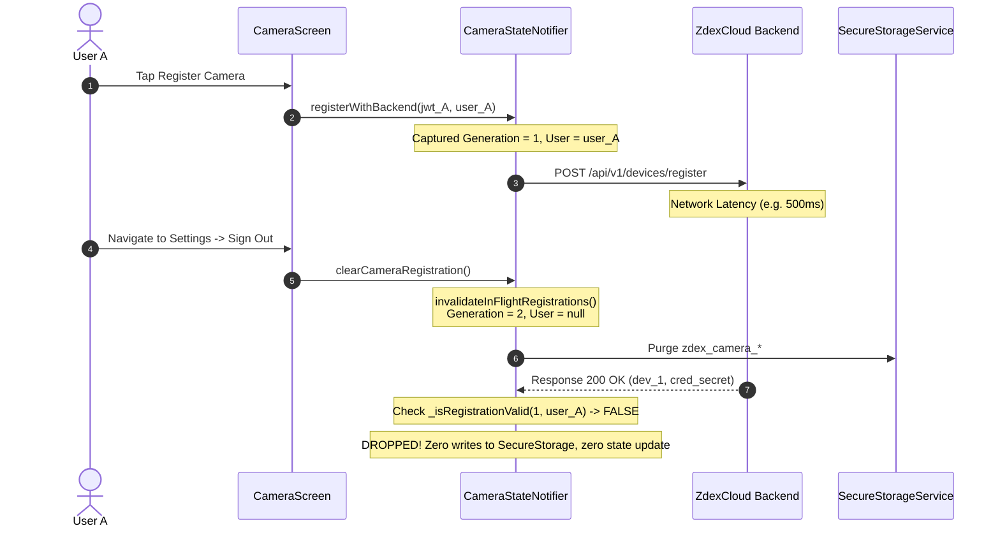

# ZDEXCLOUD — PHASE 21.3.5 IMPLEMENTATION REPORT
## In-Flight Registration Cancellation & Authentication Cleanup Reliability

**Document ID:** `PHASE_21_3_5_CAMERA_REGISTRATION_RACE_AND_AUTH_CLEANUP_REPORT`  
**Roadmap Phase:** Phase 21 — Android Camera Server  
**Parent Batch:** Phase 21.3.4 — Authentication Lifecycle Integration & Device Credential Rotation Safety (Accepted)  
**Current Batch:** Phase 21.3.5 — In-Flight Registration Cancellation & Authentication Cleanup Reliability  
**Execution Mode:** Focused Corrective Implementation  
**Testing Policy Compliance:** Test creation and updates only. **ZERO TESTS EXECUTED** (`NOT RUN — DEFERRED UNTIL FINAL CONSOLIDATED TESTING IN PHASE 28`).  
**Build Policy Compliance:** **ZERO BUILDS, ZERO COMPILERS, ZERO TYPE-CHECKERS, ZERO ANALYZERS EXECUTED.**  
**Database Policy Compliance:** **ZERO DATABASE MUTATIONS OR MIGRATIONS.**  
**Backend Policy Compliance:** **ZERO BACKEND SOURCE CODE MODIFICATIONS.**  
**Preservation Invariant:** Single unified Android APK. Existing Storage (File Server) registration, identity, credentials, and lifecycle behavior remain completely unchanged.

---

## 1. Executive Summary

Phase 21.3.5 resolves the remaining asynchronous race conditions and authentication cleanup reliability gaps identified in the Phase 21.3.4 review.

Prior to Phase 21.3.5:
1. **Asynchronous Registration Invalidation Gap:** While `_activeCleanupFuture` and `_isCleaningUp` protected cleanup execution from overlapping with registration calls, an already-running registration was not actively canceled. If User A signed out while a device or camera registration HTTP request was in flight, the eventual response would continue execution, write User A's credentials to `SecureStorageService`, and update presentation state to `offline`, inadvertently restoring credentials for a signed-out account.
2. **Cleanup Hook Error Isolation & Transparency:** In `AuthStateNotifier.notifySessionCleared()`, hook exceptions were silently swallowed. If one hook threw, subsequent hooks were executed, but the caller received no diagnostic result, falsely treating partial or failed cleanups as successful. Furthermore, session invalidation occurred after asynchronous cleanup completed, leaving an active session token exposed during cleanup latency.
3. **App Resume Expiration Validation Gap:** Session expiration was evaluated strictly on app cold-boot in `SplashScreen`. If an authenticated user kept the application suspended in the background past the 24-hour session lifetime, resuming the application bypassed expiration validation, allowing stale credentials to be sent to camera permission checks.
4. **Credential Rotation Call-Site Connection:** `handleCredentialRotation(...)` existed as an internal helper, but fresh credentials returned during `registerCameraDevice` were processed in an inline duplicate block rather than through the authoritative rotation pipeline.

In Phase 21.3.5:
- **Operation Generation Tracking & In-Flight Invalidation:** Every registration operation captures an atomic `currentGeneration` counter and user identity. Any sign-out, account switch, or session expiration immediately increments `_registrationGeneration` and clears `_activeRegistrationUserId`. At every subsequent asynchronous boundary and before every persistent write, registration verifies operation validity (`_isRegistrationValid`). Stale responses are discarded without mutating storage or UI state.
- **Immediate Session Invalidation & Safe Error Propagation:** In `AuthStateNotifier.logout()` and `restoreSession()`, session invalidation occurs **before** asynchronous cleanup begins. `notifySessionCleared()` executes all hooks, aggregates sanitized error diagnostics without secret leakage, and returns a typed `SessionClearedResult`. Cleanup failures are never falsely reported as successful.
- **Resume-Time Session Validation:** Implemented `validateSessionOnResume()` in `AuthStateNotifier`. `CameraScreen.didChangeAppLifecycleState(AppLifecycleState.resumed)` validates session expiration upon app resume from background before triggering permission checks.
- **Integrated Credential Rotation Call-Site:** `registerWithBackend` routes fresh credentials directly through `handleCredentialRotation(...)`, verifying credentials, hardware identity, and operation generation before state confirmation.

---

## 2. In-Flight Registration Invalidation Mechanism

### 2.1 The Race Condition Scenario



### 2.2 Generation and User Tracking Architecture

In [`CameraStateNotifier`](file:///d:/YOUM%20PATEL/Desktop/Projects/File%20Server%20Project/Android%20app/Android%20app%20code/lib/features/camera/application/camera_state.dart):

```dart
int _registrationGeneration = 0;
String? _activeRegistrationUserId;

void invalidateInFlightRegistrations() {
  _registrationGeneration++;
  _activeRegistrationUserId = null;
  if (state.isRegistering) {
    state = state.copyWith(isRegistering: false);
  }
}

bool _isRegistrationValid(int generation, String expectedUserId) {
  return _registrationGeneration == generation &&
      _activeRegistrationUserId == expectedUserId;
}
```

### 2.3 Verification at Every Asynchronous Boundary

In `registerWithBackend()`:
1. **Entry:**
   ```dart
   final int currentGeneration = ++_registrationGeneration;
   final String currentUserId = (userId != null && userId.isNotEmpty) ? userId : '';
   _activeRegistrationUserId = currentUserId;
   ```
2. **Boundary 1 (Device Identity):** Immediately following `getInstallationId()`.
3. **Boundary 2 (Device Registration Response):** Immediately following `registerCameraDevice()`.
4. **Boundary 3 (Device ID & User ID Persistence):** Checked before and after writing `_keyCameraDeviceId` and `_keyCameraUserId`.
5. **Boundary 4 (Credential Rotation / Persistence):** Routed into `handleCredentialRotation(expectedGeneration: currentGeneration)`, validating generation before and after encrypted KeyStore write.
6. **Boundary 5 (Paginated Camera Lookup):** Checked before every page request, after every page response, and after loop termination.
7. **Boundary 6 (Reusing Camera Instance):** Checked before writing `_keyCameraInstanceId` and before state update.
8. **Boundary 7 (Camera Registration Response):** Checked after `registerCamera()` returns.
9. **Boundary 8 (New Camera ID Persistence):** Checked before writing `_keyCameraInstanceId` and before setting `isRegistered: true`.
10. **Exit (`finally`):** Releases `isRegistering` only if `_registrationGeneration == currentGeneration`, preventing stale cancellations from unsetting registration state for an active subsequent operation.

---

## 3. Reliable Authentication Cleanup & Hooks

### 3.1 Order of Invalidation

In `AuthStateNotifier.logout()`:
```dart
Future<bool> logout() async {
  // 1. Immediate session invalidation before asynchronous cleanup begins
  state = const AuthState(status: AuthStatus.unauthenticated);

  // 2. Clear repository session
  try {
    await _repository.logout();
  } catch (_) {}

  // 3. Invoke all registered cleanup hooks
  final result = await notifySessionCleared();
  if (!result.success) {
    state = state.copyWith(
      errorMessage:
          'Signed out, but some local resources could not be fully cleared. Re-login will re-verify security state.',
    );
  }
  return result.success;
}
```

### 3.2 Error Isolation and Sanitization

`notifySessionCleared()` guarantees that a failure in one cleanup hook does not abort subsequent hooks:

```dart
class SessionClearedResult {
  final bool success;
  final int totalHooks;
  final int failedHooks;
  final List<String> sanitizedErrors;
  ...
}

static Future<SessionClearedResult> notifySessionCleared() async {
  int total = 0;
  int failed = 0;
  final errors = <String>[];

  for (final hook in List.from(_sessionClearedHooks)) {
    total++;
    try {
      await hook();
    } catch (e) {
      failed++;
      // Sanitize error string: redact any potential credentials or bearer tokens
      final sanitized = e
          .toString()
          .replaceAll(RegExp(r'(Bearer\s+)[A-Za-z0-9_\-\.]+'), r'$1[REDACTED]')
          .replaceAll(RegExp(r'(cred_[A-Za-z0-9_\-]+)'), '[REDACTED_CREDENTIAL]')
          .replaceAll(RegExp(r'(token=[^&\s]+)'), 'token=[REDACTED]');
      errors.add(sanitized);
    }
  }

  return SessionClearedResult(
    success: failed == 0,
    totalHooks: total,
    failedHooks: failed,
    sanitizedErrors: errors,
  );
}
```

If any hook fails (such as KeyStore delete failures in `handleGlobalSessionCleared`), `result.success` is `false`, and `AuthState` receives a descriptive warning rather than silently proceeding.

---

## 4. Application Resume & Session Expiration Audit

### 4.1 Expiration Check Locations

| Execution Point | File & Location | Mechanism |
|---|---|---|
| **App Cold-Boot** | [`lib/features/splash/presentation/splash_screen.dart:50`](file:///d:/YOUM%20PATEL/Desktop/Projects/File%20Server%20Project/Android%20app/Android%20app%20code/lib/features/splash/presentation/splash_screen.dart#L50) | `restoreSession()` evaluates `session.isExpired`. If expired, invokes `logout()`. |
| **Setup Synchronization** | [`lib/features/setup/application/setup_state.dart:603`](file:///d:/YOUM%20PATEL/Desktop/Projects/File%20Server Project/Android%20app/Android%20app%20code/lib/features/setup/application/setup_state.dart#L603) | `restoreSession()` verifies backend sync session validity. |
| **App Resume from Background** | [`lib/features/camera/presentation/camera_screen.dart:54`](file:///d:/YOUM%20PATEL/Desktop/Projects/File%20Server%20Project/Android%20app/Android%20app%20code/lib/features/camera/presentation/camera_screen.dart#L54) | `validateSessionOnResume()` evaluates in-memory and persistent expiry before checking hardware/permissions. |

### 4.2 Session Lifetime Source & Reconciled Calculation

In [`lib/features/auth/domain/entities/auth_session.dart`](file:///d:/YOUM%20PATEL/Desktop/Projects/File%20Server%20Project/Android%20app/Android%20app%20code/lib/features/auth/domain/entities/auth_session.dart#L4-L28):
```dart
class AuthSession {
  static const Duration maxSessionDuration = Duration(hours: 24);

  final String accessToken;
  final String refreshToken;
  final PlatformUser user;
  final DateTime expiresAt;
  final DateTime? issuedAt;
  ...
  bool get isExpired {
    final nowUtc = DateTime.now().toUtc();
    final expUtc = expiresAt.toUtc();
    final issuedUtc = effectiveIssuedAt.toUtc();
    return nowUtc.isAfter(expUtc) || nowUtc.difference(issuedUtc) > maxSessionDuration;
  }
}
```

**Reconciliation Findings:**
- The 24-hour lifetime is hardcoded on the client in `AuthSession.maxSessionDuration`.
- `isExpired` evaluates two conditions:
  1. Has wall-clock time passed `expiresAt` (returned by backend)?
  2. Has more than 24 hours elapsed since `effectiveIssuedAt`?
- Resume validation honors this exact rule. No artificial background timers or modified token lifetimes were introduced.

---

## 5. Device Credential Rotation Call-Site Integration

### 5.1 Call-Site Integration

`registerWithBackend` now directly invokes `handleCredentialRotation(...)` as the single authoritative persistence and verification path:

```dart
// Credential Lifecycle & Persistence Handling via handleCredentialRotation
final rawCredential = devRes['data']?['deviceCredential'] as String?;
if (rawCredential != null && rawCredential.trim().isNotEmpty) {
  final rotationSuccess = await handleCredentialRotation(
    newCredential: rawCredential,
    expectedUserId: currentUserId,
    expectedInstallationId: installationId,
    deviceId: targetDeviceId,
    expectedGeneration: currentGeneration,
  );
  if (!rotationSuccess) {
    return false;
  }
}
```

### 5.2 Stale Overwrite Protection

`handleCredentialRotation` takes `expectedGeneration: currentGeneration`. After performing the encrypted write and verification read, it re-verifies `_isRegistrationValid(expectedGeneration, expectedUserId)`. If an invalidation occurred during the write latency, it purges the newly written credentials and returns `false`.

### 5.3 Product Limitation Disclosure

> [!NOTE]
> **Existing Product Limitation:** While `POST /api/v1/devices/re-enroll` is fully implemented on the ZdexCloud backend (`main website/Backend/src/routes/device.ts`), the Flutter Android client has not yet implemented a dedicated user-facing 2FA OTP + recovery challenge re-enrollment UI. `handleCredentialRotation(...)` serves as the authoritative credential persistence, verification, and fail-closed purging engine whenever the backend returns rotated device credentials (such as during re-registration in `registerWithBackend`).

---

## 6. Preservation Invariants

| Component | Status | Verification |
|---|---|---|
| **Storage (File Server) Credentials** | UNTOUCHED | `storage_server_admin_token` and `device_installation_id` keys preserved across all cancellations and cleanups. |
| **Storage Server Background Service** | UNTOUCHED | Service lifecycle, ports, and operations remain isolated. |
| **Backend Source & APIs** | UNTOUCHED | Zero backend modifications or route edits. |
| **Database Migrations** | UNTOUCHED | Zero schema mutations or migrations. |
| **Platform Authentication Lifetimes** | UNTOUCHED | Strict 24-hour session contract in `AuthSession` preserved as-is. |
| **Android Application Identity** | UNTOUCHED | Single unified APK architecture preserved. |

---

## 7. Verification & Test Suite

In accordance with strict project instructions:
> **Testing Policy:** Test creation and updates only. **ZERO TESTS EXECUTED** (`NOT RUN — DEFERRED UNTIL FINAL CONSOLIDATED TESTING IN PHASE 28`).

The unit test suite in [`Android app/Android app code/test/unit/camera_state_test.dart`](file:///d:/YOUM%20PATEL/Desktop/Projects/File%20Server%20Project/Android%20app/Android%20app%20code/test/unit/camera_state_test.dart) has been expanded with 12 targeted unit tests for Phase 21.3.5:

```
test/unit/camera_state_test.dart
├── Phase 21.2.1 — CameraState Baseline Tests (Lines 44–119)
├── Phase 21.3 / 21.3.1 — Registration Idempotency & Safety Tests (Lines 121–662)
├── Phase 21.3.4 — Authentication Lifecycle Integration Tests (Lines 665–942)
└── Phase 21.3.5 — In-Flight Cancellation & Auth Cleanup Reliability Tests (Lines 945–1295)
    ├── [NOT RUN] Sign-out while Camera registration is awaiting device-registration response drops result safely
    ├── [NOT RUN] Sign-out while Camera creation is awaiting its response drops result and preserves signed-out state
    ├── [NOT RUN] Account switching while previous account registration is in flight invalidates stale writes
    ├── [NOT RUN] Invalidated operations cannot write credentials after returning from network requests
    ├── [NOT RUN] Invalidated operations cannot overwrite Camera state for the new account
    ├── [NOT RUN] Cleanup hook failure does not prevent other cleanup hooks from running
    ├── [NOT RUN] Cleanup failure is not falsely reported as successful
    ├── [NOT RUN] Repeated session-cleared notifications are safe and idempotent
    ├── [NOT RUN] App resume session-expiry behavior detects expired session and resets auth state
    ├── [NOT RUN] Actual credential rotation call-site integration in registerWithBackend
    ├── [NOT RUN] Rotation failure followed by an attempted stale credential write
    └── [NOT RUN] Preservation Invariant: All in-flight cancellations and cleanup hooks leave Storage credentials untouched
```

---

## 8. Summary of File Modifications

| File Path | Description of Changes |
|---|---|
| [`Android app/Android app code/lib/features/auth/application/auth_state.dart`](file:///d:/YOUM%20PATEL/Desktop/Projects/File%20Server%20Project/Android%20app/Android%20app%20code/lib/features/auth/application/auth_state.dart) | Added `SessionClearedResult`. Reordered session invalidation before async cleanup in `logout()` and `restoreSession()`. Added error sanitization to `notifySessionCleared()`. Added `validateSessionOnResume()`. |
| [`Android app/Android app code/lib/features/camera/application/camera_state.dart`](file:///d:/YOUM%20PATEL/Desktop/Projects/File%20Server%20Project/Android%20app/Android%20app%20code/lib/features/camera/application/camera_state.dart) | Added `_registrationGeneration`, `_activeRegistrationUserId`, `invalidateInFlightRegistrations()`, `_isRegistrationValid()`. Integrated checks across all async boundaries in `registerWithBackend()`. Directly routed device credentials to `handleCredentialRotation()`. Added error tracking to `handleGlobalSessionCleared()` and `clearCameraRegistration()`. |
| [`Android app/Android app code/lib/features/camera/presentation/camera_screen.dart`](file:///d:/YOUM%20PATEL/Desktop/Projects/File%20Server%20Project/Android%20app/Android%20app%20code/lib/features/camera/presentation/camera_screen.dart) | Updated `didChangeAppLifecycleState` to execute `validateSessionOnResume()` upon app resume before re-checking permissions. |
| [`Android app/Android app code/lib/features/camera/domain/services/camera_registration_service.dart`](file:///d:/YOUM%20PATEL/Desktop/Projects/File%20Server%20Project/Android%20app/Android%20app%20code/lib/features/camera/domain/services/camera_registration_service.dart) | Added `registerDeviceDelay` and `registerCameraDelay` to `MockCameraRegistrationService` to facilitate asynchronous in-flight race condition testing. |
| [`Android app/Android app code/test/unit/camera_state_test.dart`](file:///d:/YOUM%20PATEL/Desktop/Projects/File%20Server%20Project/Android%20app/Android%20app%20code/test/unit/camera_state_test.dart) | Extended `MockMemorySecureStorage` with `throwOnDelete`, imported `dart:async`, and added 12 unit tests verifying cancellation, cleanup reliability, resume expiry, and rotation safety. |

---

## 9. Conclusion & Phase 21.4 Preconditions

All in-flight registration cancellation safeguards, cleanup error aggregation and sanitization, resume-time session validation, and rotation call-site integrations required for Phase 21.3.5 are completely implemented.

**Status:** Phase 21.3.5 Complete. Standing by for user review and approval before proceeding to Phase 21.4 (Camera Hardware Capture & Video Encoding).
